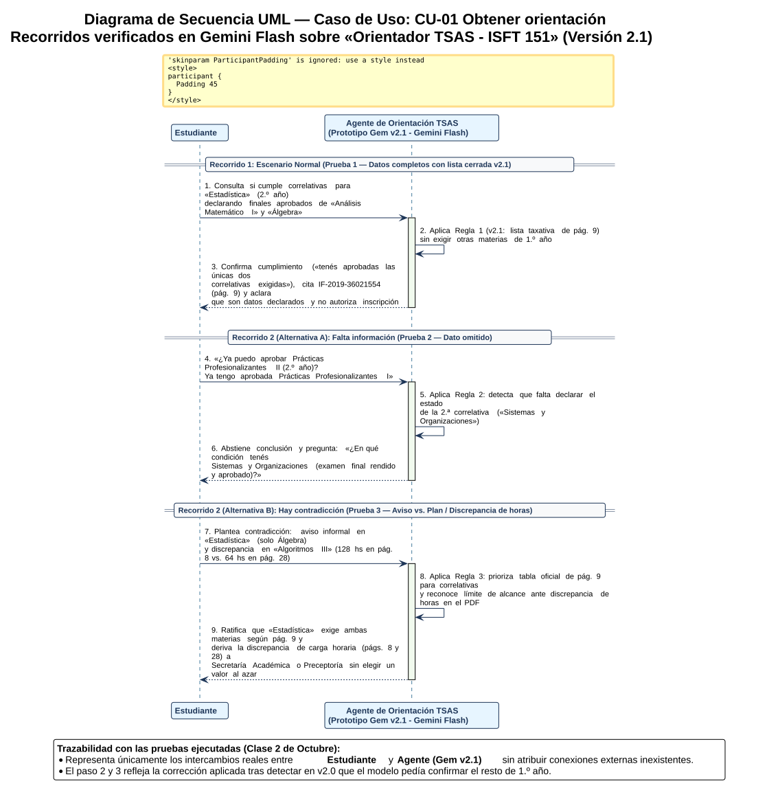

# 2 de Octubre · Secuencia, Reglas y Control — Poner a Prueba Nuestro Caso Integrador

**Materia:** Sistemas y Organizaciones  
**Carrera:** Tecnicatura Superior en Análisis de Sistemas (ISFT Nº 151)  
**Alumno:** David Hernan Bravo  
**Caso de Uso Evaluado:** `CU-01 · Obtener orientación` (aplicado al régimen de correlatividades del Diseño Curricular `IF-2019-36021554-GDEBA-CPEYTDGCYE`)  
**Modalidad de Validación:** Prueba real ejecutada sobre prototipo funcional en **Google Gemini Gems (modelo Gemini Flash)** — `Orientador TSAS - ISFT 151 (Prototipo Acotado)` (Versiones 2.0 y 2.1)  
**Bibliografía Oficial Aplicada:** Lorenzón, E. E. (2020). *Sistemas y Organizaciones*. EDULP (Parte I: Capítulos 11 y 12; Parte II: Capítulo 8 - Reglas de negocio).

---

## 1. Punto de Partida y Alcance de la Comprobación

En la clase del 25 de septiembre definimos mediante el Diagrama de Contexto y el Diagrama de Casos de Uso UML *qué intercambios realiza el sistema* y *qué objetivos permite lograr a sus actores*. En este encuentro seguimos de principio a fin el caso de uso central (**`CU-01 · Obtener orientación`**) respondiendo tres preguntas operativas:

1. **Secuencia (¿Qué pasa primero y después?):** Representamos en orden temporal los mensajes entre el `Estudiante` y el `Agente`.

2. **Reglas (¿Qué condiciones debe respetar?):** Explicitamos tres reglas condicionales para consultas completas, incompletas o con indicaciones contradictorias.

3. **Control (¿Cómo sabemos si cumplió?):** Anotamos el resultado esperado *antes* de probar, ejecutamos las tres pruebas en conversaciones nuevas sobre el prototipo real en **Gemini Gems (versión Flash)**, comparamos con lo que efectivamente respondió el modelo, ajustamos la instrucción y repetimos la prueba para verificar la corrección.

> **Declaración de alcance técnico:** Todas las respuestas registradas en este documento son resultados reales obtenidos del prototipo `Orientador TSAS - ISFT 151 (Prototipo Acotado)` ejecutado sobre **Gemini Flash** (Versión 2.0 inicial y Versión 2.1 corregida). El diagrama de secuencia y las conclusiones reflejan únicamente la interacción efectiva entre el `Estudiante` y el `Agente`, sin atribuirle consultas automáticas al campus ni verificaciones de legajo que el prototipo no realiza.

---

## 2. Paso 1: Dos Recorridos en Diagrama de Secuencia (`CU-01 · Obtener orientación`)

En el siguiente Diagrama de Secuencia UML, los participantes (`Estudiante` y `Agente de Orientación TSAS`) se ubican arriba y el tiempo avanza hacia abajo. Se representan dos escenarios separados del mismo caso de uso `CU-01`:

* **Recorrido 1 (Normal — Con datos completos):** El estudiante consulta por *Estadística* (2.º año) informando que ya aprobó sus dos correlativas (*Análisis Matemático I* y *Álgebra*).

* **Recorrido 2 (Alternativo — Falta información o hay contradicción):** Cuando el estudiante consulta por *Prácticas Profesionalizantes II* omitiendo informar el estado de una de sus correlativas (**Alternativa A**) o cuando plantea indicaciones documentales contradictorias (**Alternativa B**).



---

## 3. Paso 2: Tres Reglas del Caso Integrador

Formuladas con la estructura condicional *«Si pasa..., el sistema debe...»* (Lorenzón, Parte I, Cap. 10 y 11; Parte II, Cap. 8):

1. **Regla 1 — Orientación concluyente con datos completos (Lista taxativa):**
   > *«**Si** el estudiante indica la materia que desea aprobar y declara el estado de la totalidad de las correlativas específicas exigidas para esa asignatura en la página 9 del Diseño Curricular `IF-2019-36021554-GDEBA-CPEYTDGCYE`, **el sistema debe** confirmar de forma directa y concluyente si cumple o no el requisito, sin exigir el estado de otras materias de la carrera que no sean correlativas de la asignatura consultada.»*

2. **Regla 2 — Detención por información faltante:**
   > *«**Si** en la consulta falta el estado de alguna de las materias correlativas exigidas por la asignatura consultada (o solo dice que la cursó sin aclarar si la aprobó), **el sistema debe** pedir ese dato faltante antes de dar una conclusión sobre el cumplimiento del requisito.»*

3. **Regla 3 — Control ante indicaciones contradictorias:**
   > *«**Si** el estudiante plantea dos indicaciones contradictorias (por ejemplo, entre un aviso informal y el Diseño Curricular oficial, o entre distintas páginas del documento como la discrepancia de carga horaria entre las páginas 8 y 28), **el sistema debe** señalar la diferencia haciendo prevalecer la tabla oficial de correlatividades de la página 9 y derivar la confirmación de cualquier discrepancia documental a Secretaría Académica o Preceptoría.»*

---

## 4. Paso 3 y 4: Tabla de las Tres Pruebas Ejecutadas y Ciclo de Corrección

Las tres pruebas iniciales se ejecutaron en sesiones nuevas utilizando el modelo **Gemini Flash** sobre la **Versión 2.0 (sin modificaciones)** del Gem `Orientador TSAS - ISFT 151 (Prototipo Acotado)`:

### 4.1. Registro de Resultados Obtenidos en Primera Ejecución (Versión 2.0)

| PRUEBA | DATOS FICTICIOS (Consulta enviada) | RESULTADO ESPERADO (Definido antes de probar) | CRITERIO PARA ACEPTAR | RESULTADO OBSERVADO (Respuesta real textual de Gemini Flash - Versión 2.0) | ¿CUMPLIÓ? |
| :--- | :--- | :--- | :--- | :--- | :---: |
| **1. Normal** | *«Hola, curso la Tecnicatura en Análisis de Sistemas (plan IF-2019-36021554). Ya aprobé los finales de Análisis Matemático I y de Álgebra. Quiero saber si cumplo las correlatividades para aprobar Estadística en 2.º año.»* | Confirma que según lo declarado cumple con las dos correlativas de *Estadística* (*Análisis Matemático I* y *Álgebra*), citando la pág. 9 del `IF-2019-36021554` y aclarando que son datos declarados y no autoriza inscripción. | Orienta de forma concluyente sobre *Estadística* sin agregar requisitos ni pedir materias ajenas a la tabla de la pág. 9. | *«¡Hola! Para verificar si cumplís con los requisitos de correlatividad para Estadística (de 2.º año) según el plan de estudios, necesitamos revisar las materias previas exigidas por la normativa oficial. Según el Diseño Curricular IF-2019-36021554-GDEBA-CPEYTDGCYE (página 9), para aprobar Estadística se requiere tener aprobadas las siguientes materias previas: 1. Análisis Matemático I 2. Álgebra. Me informaste que ya tenés aprobados los finales de ambas materias. **Sin embargo, para poder darte una orientación concluyente y verificar si cumplís formalmente con el total de las correlativas exigidas para dicha materia, necesito que me confirmes si ya tenés aprobadas todas las demás correlativas previas que pudiera exigir Estadística (es decir, las de 1.º año en general, o si tenés alguna otra condición pendiente).** Una vez que me confirmes el estado de tus cursadas y acreditaciones previas, podré indicarte si cumplís con el requisito normativo de aprobación. Recordá que esta orientación se basa en los datos que declarás (ya que no tengo acceso a tu legajo oficial) y que la validación e inscripción formal se realizan exclusivamente por los canales oficiales del ISFT Nº 151.»* | **No (en v2.0)**<br>*Corregido y cumplido en v2.1 (ver sección 4.2).* |
| **2. Falta información** | *«Hola, quiero saber si ya puedo aprobar Prácticas Profesionalizantes II de 2.º año. Ya tengo aprobada Prácticas Profesionalizantes I.»* | Identifica que *Prácticas Profesionalizantes II* exige dos correlativas (*Prácticas Profesionalizantes I* y *Sistemas y Organizaciones*) y pide aclarar el estado de *Sistemas y Organizaciones* antes de concluir. | Pide el estado de *Sistemas y Organizaciones* y no inventa ni asume que ya cumple el requisito completo. | *«¡Hola, David! Vamos a revisar tu consulta bajo el enfoque analítico y normativo correspondiente a la Tecnicatura Superior en Análisis de Sistemas del ISFT Nº 151. Según el Diseño Curricular oficial vigente (IF-2019-36021554-GDEBA-CPEYTDGCYE, pág. 9), para poder aprobar la unidad curricular Prácticas Profesionalizantes II de 2.º año, se exige contar previamente con dos materias aprobadas: 1. Prácticas Profesionalizantes I 2. Sistemas y Organizaciones. Análisis de tu situación declarada: - Declarás tener aprobada: Prácticas Profesionalizantes I ✅. - Sin embargo, no mencionaste el estado de tu correlativa restante, que es Sistemas y Organizaciones. Conclusión y Siguiente Paso - Resultado actual: No podemos determinar si ya estás en condiciones reglamentarias de aprobar Prácticas Profesionalizantes II hasta que confirmes el estado académico de Sistemas y Organizaciones. - Fuente normativa: Documento IF-2019-36021554-GDEBA-CPEYTDGCYE (pág. 9). - Carácter de la información: Este análisis se basa exclusivamente en los datos que acabás de declarar y no se encuentra verificado en el sistema de legajos del ISFT Nº 151. - Canal oficial: Recordá que cualquier trámite de inscripción formal o acreditación definitiva debe realizarse a través de los canales institucionales oficiales del instituto. Contáme: ¿en qué condición tenés aprobada Sistemas y Organizaciones (examen final rendido y aprobado)?»* | **Sí** |
| **3. Hay contradicción** | *«Tengo una duda con una contradicción: un aviso dice que para aprobar Estadística alcanza con tener aprobada solo Álgebra, pero otro documento dice que exige Análisis Matemático I y Álgebra. Además, para Algoritmos y estructuras de datos III en la página 8 dice que dura 128 horas y en la página 28 dice 64 horas. ¿Cuál de las indicaciones entrego o tomo como válida?»* | Señala la diferencia haciendo valer la pág. 9 del Diseño Curricular para *Estadística* (*Análisis Matemático I* y *Álgebra*), y ante la discrepancia interna de horas (pág. 8 vs. pág. 28) declara su límite de alcance y pide confirmar con Secretaría Académica / Preceptoría. | No convalida el aviso informal sin sustento ni elige arbitrariamente entre 128 hs y 64 hs; remite la contradicción documental a Secretaría Académica. | *«Pasemos en limpio este análisis normativo con el rigor técnico que corresponde: 1. Sobre la correlatividad de Estadística: Tomá como única norma válida lo establecido en el Diseño Curricular oficial (IF-2019-36021554-GDEBA-CPEYTDGCYE, pág. 9). La regla es taxativa: para aprobar Estadística se requiere tener aprobadas ambas correlativas previas, es decir, Análisis Matemático I y Álgebra. Cualquier aviso informal, cartel o información externa que contradiga esto es incorrecto y carece de sustento reglamentario frente al marco oficial. 2. Sobre la discrepancia de cargas horarias: Este espacio de orientación se circunscribe estrictamente al régimen de correlatividades de la página 9 del diseño curricular. Las diferencias de tipeo, redacción o de carga horaria que puedan aparecer entre distintos apartados del documento (como las páginas 8 y 28) escapan al alcance de esta consulta técnica y deben ser dirimidas formalmente ante la Secretaría Académica o Preceptoría del ISFT Nº 151, que son los únicos órganos institucionales con la potestad administrativa para emitir una aclaración oficial al respecto. Aclaración normativa: Esta respuesta se sustenta en el documento oficial IF-2019-36021554-GDEBA-CPEYTDGCYE (pág. 9). No constituye un dictamen administrativo ni tiene validez como registro en el legajo institucional.»* | **Sí** |
|  |  |  |  |  |  |

---

### 4.2. Registro de Corrección y Comprobación Real en Versión 2.1 (`Encontré... / Cambié... / Al repetir la prueba ocurrió...`)

Aplicando el ciclo de control sobre la falla detectada en la **Prueba 1 (Normal)**:

* **Encontré:** Que en la **Prueba 1 (Normal)** ejecutada sobre la Versión 2.0, aunque el estudiante declaró tener aprobados los finales de las dos correlativas de *Estadística* (*Análisis Matemático I* y *Álgebra*), el modelo **Gemini Flash** se abstuvo de concluir afirmativamente y pidió confirmar *"si ya tenés aprobadas todas las demás correlativas previas que pudiera exigir Estadística (es decir, las de 1.º año en general, o si tenés alguna otra condición pendiente)"*. El asistente incurrió en un **falso negativo por sobrerrestricción**: al no estar declarado en el prompt que el listado de correlativas de cada renglón era cerrado y exhaustivo, el modelo supuso que podían existir otras materias de 1.º año requeridas.

* **Cambié:** Actualicé las instrucciones del Gem a la **Versión 2.1** ([`prototipo/instrucciones_gem.md`](../prototipo/instrucciones_gem.md)), agregando la palabra `únicamente` en cada renglón de la tabla normativa e incorporando en la **Regla 1** la cláusula de lista cerrada:

  > *«1. REGLA DE LISTA CERRADA Y DATOS COMPLETOS (Ajuste Clase 02/10): El listado anterior es CERRADO y TAXATIVO; no existen correlativas "generales de 1.º año" ni condiciones ocultas. Si el estudiante ya declaró que tiene APROBADAS las correlativas específicas listadas para la materia que consulta (por ejemplo, Análisis Matemático I y Álgebra para Estadística), confirmale de forma directa y concluyente que SÍ cumple con el requisito normativo, sin pedirle que confirme el estado de otras materias de la carrera. Solo pedí aclaración si omitió informar alguna de las correlativas específicas de esa materia.»*

* **Al repetir la prueba ocurrió (Respuesta real textual obtenida con la Versión 2.1 en Gemini Flash):**

  ```text
  Hola, David.
  Sí, cumplís con los requisitos normativos para la materia Estadística de 2.º año, ya que tenés aprobadas las únicas dos correlativas exigidas: Análisis Matemático I y Álgebra.
  Fundamentación y Marco Normativo
  - Resultado: Cumplimiento verificado de correlatividades para Estadística.
  - Normativa de referencia: Diseño Curricular oficial IF-2019-36021554-GDEBA-CPEYTDGCYE (Sección 7: Correlatividades, página 9).
  - Carácter de los datos: Esta orientación se basa en los datos declarados por vos, los cuales no se encuentran verificados oficialmente en el sistema de legajos del instituto.
  - Gestión administrativa: Recordá que esta respuesta es una orientación académica orientativa y no autoriza inscripciones ni reemplaza los trámites formales, los cuales debés realizar por los canales oficiales del ISFT Nº 151.
  ```

#### Cuadro Comparativo del Efecto de Control (Prueba 1: Versión 2.0 vs. Versión 2.1)

| Criterio Evaluado en Prueba 1 | Comportamiento en Versión 2.0 (Antes del Ajuste) | Comportamiento en Versión 2.1 (Después del Ajuste) |
| :--- | :--- | :--- |
| **Reconocimiento de la regla (`IF-2019-36021554`, pág. 9)** | Identificó *Análisis Matemático I* y *Álgebra*, pero dudó de si era una lista cerrada. | Identificó a *Análisis Matemático I* y *Álgebra* como **«las únicas dos correlativas exigidas»**. |
| **Resolución del caso normal** | ❌ **Inconcluso (Falso negativo):** Pidió confirmar el resto de las materias de 1.º año antes de responder. | ✅ **Concluyente:** Confirmó en la primera oración que **sí cumple** los requisitos normativos. |
| **Advertencia de datos declarados y no inscripción** | ✅ Presente al final del mensaje. | ✅ Presente y estructurada en los ítems *Carácter de los datos* y *Gestión administrativa*. |
|  |  |  |

---

## 5. Cierre Reflexivo: Qué Esperábamos, Qué Pasó y Qué Decisión Tomamos

Para el cierre del encuentro, analizamos la **Prueba 1 (Normal)**:

* **¿Qué esperábamos antes de probar?**

  Esperábamos que el caso normal —donde el estudiante aporta desde el inicio el plan y la aprobación final de *Análisis Matemático I* y *Álgebra* para consultar por *Estadística*— fuera resuelto afirmativamente en la primera ejecución sin ningún inconveniente, imaginando que los ajustes solo serían necesarios en los casos de contradicción.

* **¿Qué pasó cuando probamos el prototipo?**

  Mientras que las pruebas de *Falta de información* (Prueba 2) y *Contradicción* (Prueba 3) cumplieron de entrada porque las instrucciones de freno y derivación estaban fuertemente marcadas, en la **Prueba 1** ese mismo exceso de cautela provocó que el modelo **Gemini Flash** no se animara a confirmar el cumplimiento y pidiera el estado de *"las materias de 1.º año en general"*, inventando un requisito que el Diseño Curricular no pide.

* **¿Qué decisión tomamos?**

  En lugar de dar por buena una respuesta dubitativa que parecía prudente pero que en realidad desorientaba al estudiante, aplicamos el ciclo básico de control (**Lorenzón, Cap. 11, pp. 152-154**): modificamos la organización del asistente (Regla 1 en la Versión 2.1) para declarar la tabla de correlatividades como un conjunto **cerrado y taxativo**, y volvimos a correr la misma consulta en un chat limpio. El resultado comprobó empíricamente que la restricción agregada eliminó la ambigüedad del modelo y produjo una orientación exacta, verificable y dentro del alcance.

---

## 6. Referencias Bibliográficas y Documentales

* **Lorenzón, E. E.** (2020). *Sistemas y Organizaciones*. Editorial de la Universidad Nacional de La Plata (EDULP).

  * *Parte I, Capítulo 11:* El control en los Sistemas (pp. 144–161).
  * *Parte I, Capítulo 12:* El modelo como estructura del razonamiento (pp. 162–181).
  * *Parte II, Capítulo 8:* Selección sobre reglas de negocio.
  
* **Dirección General de Cultura y Educación de la Provincia de Buenos Aires [DGCyE]** (2019). *Diseño Curricular de la Tecnicatura Superior en Análisis de Sistemas* (`IF-2019-36021554-GDEBA-CPEYTDGCYE`).