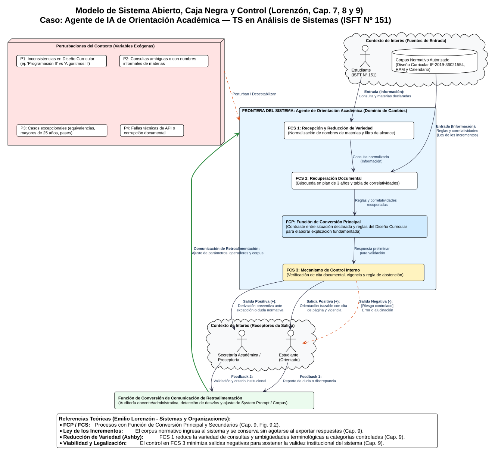

# Clase 12: Del Sistema al Agente de IA — Modelo Sistémico Preliminar

**Materia:** Sistemas y Organizaciones  
**Carrera:** Tecnicatura Superior en Análisis de Sistemas (ISFT Nº 151)  
**Alumno:** David Hernan Bravo  
**Bibliografía Oficial Aplicada:** Lorenzón, E. E. (2020). *Sistemas y Organizaciones*. EDULP (Capítulos 7, 8 y 9).  
**Corpus Normativo de Referencia:** Diseño Curricular de la Tecnicatura Superior en Análisis de Sistemas (`IF-2019-36021554-GDEBA-CPEYTDGCYE`, DGCyE Provincia de Buenos Aires).  

---

## 1. Situación Problemática y Formulación del Problema (`01-problema`)

### 1.1. Descripción de la situación problemática (sin anticipar la herramienta)

En el Instituto Superior de Formación Técnica Nº 151, los estudiantes de la Tecnicatura Superior en Análisis de Sistemas (plan de 1856 horas reloj distribuido en tres años y cuatro campos de formación) necesitan consultar de forma recurrente las condiciones académicas y administrativas que regulan su trayectoria: régimen de correlatividades para cursar o acreditar unidades curriculares, requisitos de ingreso y regularidad, certificaciones intermedias (como el certificado de Capacitación Laboral en Inglés Nivel 3 - B1 según Res. Nº 741/13 al acreditar Inglés I, II y III), fechas del calendario académico y trámites de equivalencias.

Actualmente, la información normativa oficial existe, pero se encuentra fragmentada en distintos documentos y canales institucionales (Diseño Curricular `IF-2019-36021554-GDEBA-CPEYTDGCYE`, Régimen Académico Marco, disposiciones internas, carteleras y comunicaciones de Preceptoría o Secretaría Académica). Para responder una duda concreta —por ejemplo, *"¿Puedo acreditar Ingeniería de Software I o Prácticas Profesionalizantes II en 2.º año si regularicé Algoritmos y Estructuras de Datos I pero todavía debo el final de Sistemas y Organizaciones?"*, o bien *"¿Qué finales debo aprobar en 1.º año para poder acreditar Estadística y Análisis Matemático II?"*—, el estudiante debe localizar los documentos vigentes, cruzar la tabla de correlatividades con su situación académica particular e interpretar terminología técnico-administrativa. A esto se suma que los propios documentos oficiales contienen ambigüedades: por ejemplo, en la página 9 del Diseño Curricular se exige como correlativa para 3.º año una materia llamada *"Programación II"*, cuando en la estructura curricular de 2.º año (página 8) la asignatura se denomina formalmente *"Algoritmos y Estructuras de Datos II"*.

* **¿Quién experimenta el problema?** Primariamente los estudiantes (ingresantes de 1.º año y estudiantes avanzados de 2.º y 3.º año) que deben tomar decisiones sobre su inscripción a cursadas y mesas de examen; secundariamente, el personal de Preceptoría y Secretaría Académica.

* **¿Dónde ocurre?** En los canales de comunicación institucional y atención administrativa del instituto, con picos críticos durante las semanas previas a las inscripciones anuales/cuatrimestrales y llamados a exámenes finales.

* **¿Qué evidencia permite reconocerlo?** 

  1. Reiteración de las mismas consultas operativas y reglamentarias ante preceptores y secretarios sobre el plan de estudios y sus 22 unidades curriculares.

  2. Errores de interpretación por parte de los alumnos al intentar inscribirse o rendir materias cuyas correlativas no cumplen (por ejemplo, desconocer que *Estadística* exige tener aprobadas tanto *Análisis Matemático I* como *Álgebra*, o que *Prácticas Profesionalizantes II* exige tanto *Prácticas Profesionalizantes I* como *Sistemas y Organizaciones*).

  3. Confusiones derivadas de inconsistencias en la documentación oficial (como la discrepancia de nombres entre *"Programación II"* y *"Algoritmos y Estructuras de Datos II"*, o diferencias de carga horaria entre la grilla de la página 8 y el desarrollo de las páginas 28 y 29 del Diseño Curricular).

  4. Demoras en los tiempos de respuesta administrativa debido a la sobrecarga de consultas de rutina que restan tiempo al tratamiento de trámites complejos (equivalencias, pases, inscripción de mayores de 25 años sin título secundario completo, certificados).

### 1.2. Objetivo verificable y límites de alcance

* **Objetivo del Sistema:** Orientar de manera inmediata, precisa y trazable a los estudiantes sobre la estructura curricular, el régimen de correlatividades, condiciones de cursada/acreditación y calendario académico de la Tecnicatura Superior en Análisis de Sistemas, contrastando la situación declarada por el alumno con el corpus normativo oficial vigente e indicando explícitamente la fuente documental, página/sección y fecha de vigencia.

* **Acciones prohibidas / Fuera de alcance:**

  1. El sistema **no inscribe, no matricula ni registra trámites** en el sistema de gestión oficial del instituto.

  2. El sistema **no emite dictámenes vinculantes ni autoriza excepciones** reglamentarias (como condicionalidades, pases o equivalencias).

  3. El sistema **tiene prohibido inferir, suponer o inventar reglas** cuando la información no conste en el corpus autorizado; ante cualquier vacío normativo, ambigüedad o contradicción documental no saldada por una regla oficial, debe abstenerse de concluir y derivar la consulta a Secretaría Académica o Preceptoría.

---

## 2. Delimitación y Modelo Sistémico (`02-modelo-sistemico`)

### 2.1. Foco de atención, Frontera y Dominio de Cambios
Siguiendo a **Lorenzón (Cap. 7)**, el sistema no es la realidad completa sino un recorte (modelo) construido por el observador sobre un *Universo del Discurso* o foco de atención. Trazar la frontera implica delimitar el **dominio de cambios**: todo lo que queda dentro de la frontera está bajo control del analista y puede diseñarse, reorganizarse o ajustarse; lo que queda fuera opera como condición del entorno o perturbación.

* **Elementos Endógenos (Dentro de la Frontera - Bajo control del diseño):**

  1. **Interfaz conversacional de consulta:** Punto de ingreso de la solicitud del estudiante y presentación de la respuesta.

  2. **Instrucciones del sistema y reglas operativas (System Prompt):** Parámetros de comportamiento, equivalencias terminológicas validadas, restricciones de alcance y formato de respuesta exigido.

  3. **Base de conocimiento / Corpus documental autorizado:** Repositorio acotado con versiones vigentes del Diseño Curricular (`IF-2019-36021554-GDEBA-CPEYTDGCYE`), tabla de correlatividades, Régimen Académico y calendario institucional.

  4. **Motor de recuperación y procesamiento (Modelo de IA + Buscador documental):** Mecanismo encargado de localizar la regla pertinente y redactar la explicación.

  5. **Módulo lógico de control y derivación:** Reglas de validación que verifican si la consulta tiene respaldo documental o si debe derivarse a un humano.

* **Elementos Exógenos (Fuera de la Frontera - Sin control del sistema):**
  1. **Estudiantes:** Generadores de las consultas con distintos niveles de claridad y situaciones académicas particulares.

  2. **Secretaría Académica y Preceptoría:** Autoridades institucionales con potestad de decisión administrativa y validación normativa.

  3. **Sistema de Gestión Académica Oficial (Legajos / Actas):** Base de datos oficial donde se asientan las calificaciones e inscripciones definitivas.

  4. **Dirección General de Cultura y Educación (DGCyE) / Consejo Provincial de Educación y Trabajo (COPRET):** Entes provinciales del entorno lejano que dictan o modifican los diseños curriculares y resoluciones (como el `IF-2019-36021554-GDEBA-CPEYTDGCYE` o la `Res. Nº 741/13`).

### 2.2. Análisis del Área Gris (Límite de Interés Relacional)

Lorenzón (Cap. 7) advierte que entre el sistema y el contexto suele existir un **"área gris"** sujeta a decisiones de diseño y negociación. En nuestro caso, el área gris principal es **el acceso a la historia académica individual del estudiante**:

* **Alternativa 1 (Frontera estrecha - Adoptada para este proyecto):** La historia académica queda **fuera de la frontera automática**. Es el propio estudiante quien declara en su consulta qué unidades curriculares tiene cursadas o aprobadas.

* **Alternativa 2 (Frontera ampliada):** Integrar al agente mediante una API de solo lectura con la base de datos del Sistema de Gestión Académica para que consulte automáticamente el legajo del alumno.

* **¿Qué cambia al mover este límite?**

  Si ampliamos la frontera (Alternativa 2), aumentamos la exactitud de los datos de entrada (evitando que el alumno se equivoque al recordar su estado académico), pero incrementamos drásticamente la complejidad técnica, los riesgos de privacidad/seguridad de datos personales (protección de datos sensibles, credenciales, autenticación) y la dependencia de permisos institucionales. Al mantener una frontera acotada (Alternativa 1), reducimos el costo y aseguramos la viabilidad del prototipo, compensando el riesgo mediante una advertencia explícita en la salida: *"Esta orientación se basa en los datos declarados por vos y no reemplaza la verificación en tu legajo oficial"*.

### 2.3. Contexto de Interés vs. Metasistema

No todo lo que existe en el universo exterior afecta al agente. Aplicando la distinción de **Lorenzón (Cap. 7)** y la **Curva de Confiabilidad (curva ABC)**:

* **Contexto de Interés (Entorno Próximo):** Integrado por los Estudiantes de la carrera, Preceptoría/Secretaría Académica, el Diseño Curricular `IF-2019-36021554-GDEBA-CPEYTDGCYE` (estructura de 1.º, 2.º y 3.º año y correlatividades), el Régimen Académico Marco y el Calendario Académico anual. Estas pocas variables concentran más del 80-90% de la incidencia sobre el comportamiento del sistema.

* **Variables Parametrizadas (Fuera del límite de interés):** Otros sistemas del instituto o del metasistema educativo (como el servicio de mantenimiento edilicio, la cooperadora, el régimen estatutario de designación docente o los diseños curriculares de otras carreras del ISFT Nº 151 no incluidas en el corpus) se consideran *parametrizados* (permanecen inactivos respecto a nuestro foco de análisis), ya que incluirlos dispararía el costo de modelado sin aportar una mejora significativa en la confiabilidad del agente.

### 2.4. Relaciones: Sinergia, Conglomerado y Recursividad

Aplicando las categorías del **Capítulo 8 de Lorenzón**:

* **Diferencia entre Conglomerado y Sistema (Efecto Sinérgico):**

  Si tuviéramos por un lado el archivo PDF del Diseño Curricular suelto en una carpeta, por otro un modelo de lenguaje genérico sin instrucciones específicas, y por otro el calendario en una cartelera, tendríamos un **conglomerado**: partes reunidas cuya suma no resuelve el problema (el alumno sigue sin obtener una respuesta cruzada confiable y el modelo genérico puede "alucinar" reglas inexistentes o confundirse con el nombre *"Programación II"* de la página 9).
  La **sinergia positiva** emerge únicamente cuando existe *afinidad e integración* entre los componentes: cuando las instrucciones de control obligan al modelo a consultar exclusivamente el corpus normativo vigente, cruzarlo con los datos ingresados por el alumno y estructurar una salida con cita documental precisa. Según la definición de Fuller citada por Lorenzón, examinar el modelo de IA por separado o leer el PDF del Diseño Curricular de forma aislada no permite deducir ni explicar la conducta orientadora y controlada del agente en funcionamiento ($2 + 2 = 5$).

* **Niveles de Recursividad (Jerarquía Sistémica):**

  La recursividad establece que un objeto sinérgico está compuesto por partes que son a su vez sistemas (subsistemas) y forma parte de una totalidad mayor (supersistema o metasistema), conservando propiedades sistémicas (entradas, conversión, salidas y control) en cada escala:

  1. **Nivel Superior (Supersistema / Metasistema):** El **Sistema Institucional de Gestión y Orientación Académica del ISFT Nº 151** (que abarca docentes, preceptores, secretaría, normativas, aulas y alumnos).

  2. **Nivel Foco (Sistema):** El **Agente de IA de Orientación Académica**, que actúa como un subsistema de apoyo dentro del instituto.

  3. **Nivel Inferior (Subsistemas dentro del Agente):**

     * *Subsistema de Interpretación y Filtro (Reductor de variedad):* Recibe el texto libre del alumno, normaliza los nombres de las materias (ej. traduce *"Programación II"* o *"Algoritmos 2"* a *Algoritmos y Estructuras de Datos II*) y valida si el tema pertenece al ámbito académico.

     * *Subsistema de Recuperación y Contraste Normativo:* Busca en el corpus las reglas específicas de correlatividad, carga horaria o contenidos mínimos y verifica su cumplimiento lógico.

     * *Subsistema de Control y Derivación:* Evalúa si la respuesta generada posee respaldo documental completo o si debe disparar el protocolo de derivación a Preceptoría.

  *(Nota teórica de Lorenzón, Cap. 8: Una pieza aislada como un archivo de texto plano o un botón de la interfaz es simplemente un **componente**, no un subsistema, porque carece por sí mismo de viabilidad y proceso de conversión autónomo).*

---

## 3. Representación de Flujos, Apertura y Control (`03-flujos-y-control`)

### 3.1. El Agente como Sistema Abierto y Caja Negra

De acuerdo con el **Capítulo 9 de Lorenzón**, el agente se modela como un **sistema abierto** en tanto mantiene un intercambio permanente de flujos (principalmente de información y energía computacional) con su contexto de interés. A su vez, para que el sistema completo sea *viable* (en el sentido de Lorenzón: capaz de importar por sus propios medios la energía necesaria para sobrevivir y ser "legalizado" por su entorno), el agente técnico se concibe integrado con la supervisión humana institucional que actualiza su corpus y sostiene su infraestructura.

Inicialmente representamos al sistema mediante el enfoque de **Caja Negra** (entradas, salidas y retroalimentación), y simultáneamente aplicamos la **"lupa de la investigación"** (Lorenzón, Cap. 9) para distinguir en su interior los **Procesos con Función de Conversión Principal (FCP)** y los **Procesos con Función de Conversión Secundarios (FCS)**.

### 3.2. Detalle de Corrientes y Transformación

| Categoría Sistémica | Manifestación en el Agente de Orientación Académica | Fundamentación Teórica (Lorenzón, Cap. 9) |
| :--- | :--- | :--- |
| **Corrientes de Entrada (Inputs)** | 1. **Información operativa:** Consulta del estudiante (materia de 1.º, 2.º o 3.º año a cursar/acreditar, materias aprobadas declaradas). 2. **Información normativa:** Documentos oficiales autorizados (Diseño Curricular `IF-2019-36021554-GDEBA-CPEYTDGCYE`, Régimen Académico, calendario). 3. **Instrucciones (Parámetros/Operadores):** Reglas del *System Prompt*. 4. **Energía:** Capacidad de cómputo y suministro eléctrico/red que sostiene la plataforma. | La energía responde a la **Ley de la Conservación**, pero la información normativa y las instrucciones cumplen la **Ley de los Incrementos**: cuando el agente consulta el Diseño Curricular y se lo explica al alumno, el sistema *no pierde* esa información; permanece en su memoria documental para futuras consultas. |
| **Conversión Secundaria (FCS)** | **FCS 1 (Recepción y Reducción de Variedad):** Normaliza la pregunta del alumno, mapea nombres de materias y filtra temas ajenos. **FCS 2 (Búsqueda Documental):** Localiza los fragmentos exactos del Diseño Curricular y reglamento. **FCS 3 (Control Interno):** Verifica que la respuesta cite la fuente oficial y no invente reglas. | Aplican el **Principio de Variedad Requerida de Ashby**: la variedad de formas en que cientos de alumnos pueden redactar sus dudas es casi infinita; las FCS reducen esa variedad clasificándola en intenciones acotadas (correlatividades, cargas horarias, contenidos, fechas) que la FCP puede absorber y procesar. |
| **Conversión Principal (FCP)** | **FCP (Contraste y Generación Orientadora):** Cruza la regla oficial recuperada (ej. tabla de correlatividades de pág. 9 del Diseño Curricular) con los antecedentes declarados por el alumno y construye la explicación paso a paso de qué requisitos cumple y cuáles tiene pendientes. | Es el proceso que elabora directamente el "producto característico" para el cual fue diseñado el sistema (la orientación académica trazable). |
| **Corrientes de Salida (Outputs)** | **Salidas Positivas (Útiles al contexto):** 1. Orientación fundamentada detallando correlativas cumplidas/pendientes, citando documento, página y vigencia. 2. Derivación clara y preventiva a Preceptoría/Secretaría cuando el caso excede el alcance. **Salidas Negativas (Riesgos a minimizar):** 1. Respuesta ambigua o error de interpretación (alucinación) que induzca al alumno a una inscripción o preparación de examen fallida. | Según Lorenzón, la supervivencia y **"legalización"** del sistema por parte de la comunidad educativa depende de que sus corrientes de salida positivas superen ampliamente a las negativas. Una sola salida negativa grave (informar mal una correlatividad crítica) deteriora la confianza y amenaza la viabilidad del sistema. |
| **Retroalimentación (Feedback) y Ciclo de Actividad** | **Comunicación de Retroalimentación (Control):** 1. Validación de Secretaría Académica o docentes detectando errores o ambigüedades en respuestas. 2. Re-preguntas o reportes de confusión del estudiante. *Función de Conversión de Retroalimentación:* El administrador analiza esos reportes y corrige el *System Prompt* o aclara el corpus. **Ciclo de Actividad:** Al resolver dudas rutinarias con éxito (salida positiva), el instituto valida la utilidad del agente y mantiene el soporte, tiempo de actualización y acceso (nuevas entradas) que aseguran su continuidad. | La retroalimentación actúa como el "bastón del caminante ciego" (ejemplo de Parsegian en Lorenzón, Cap. 9): mide el desvío entre la salida real y el objetivo esperado, pasando por una función de conversión que traduce el error detectado en un ajuste concreto de las instrucciones u operadores del sistema. |
|  |  |  |

### 3.3. Perturbaciones del Entorno (Mínimo 3 exigidas)

Las perturbaciones son variaciones o anomalías en las variables exógenas del contexto que tienden a desestabilizar el funcionamiento del sistema:

1. **P1 - Inconsistencias internas en documentos oficiales o desfasaje normativo:** Discrepancias reales presentes en el texto oficial del Diseño Curricular `IF-2019-36021554-GDEBA-CPEYTDGCYE` (como llamar *"Programación II"* en la tabla de correlatividades de la pág. 9 a la materia que en la pág. 8 y pág. 20 se denomina *"Algoritmos y Estructuras de Datos II"*, o la diferencia de carga horaria de *Algoritmos y Estructuras de Datos III* y *Prácticas Profesionalizantes III* entre la tabla de la pág. 8 y el texto de las págs. 28-29), así como cambios de fechas en el calendario académico aún no cargados en el corpus.

2. **P2 - Entradas ambiguas, incompletas o con denominaciones informales:** Estudiantes que consultan usando nombres coloquiales (*"¿Puedo rendir Ingeniería 1 si debo Sistemas?"*, *"¿Qué pide Base de Datos?"*) sin especificar el nombre completo de la asignatura ni si la tienen solo cursada (regularizada) o aprobada con examen final.

3. **P3 - Solicitudes de casos excepcionales o trámites especiales:** Consultas sobre equivalencias externas provenientes de otras carreras o universidades, inscripción de aspirantes mayores de 25 años sin estudios secundarios completos (prevista en la pág. 5 del Diseño Curricular sujeta a normativa específica), pases de instituto o reclamos por actas de examen.

4. **P4 - Fallas técnicas de infraestructura:** Caída temporal del servicio de inferencia, límite de cuota de tokens o errores de lectura en tablas del documento fuente.

### 3.4. Mecanismos de Control y Criterios de Derivación Humana

El éxito del agente no se mide por *"responder absolutamente todo"*, sino por **mantenerse estrictamente dentro de su dominio de confiabilidad**.

* **Detección de error o incertidumbre:** Antes de emitir la salida final, el sistema verifica: (a) ¿Están todos los datos necesarios en la consulta del alumno?, (b) ¿Existe el fragmento normativo explícito en el corpus?, (c) ¿Es un caso estándar reglado o una excepción administrativa?

* **¿Quién valida?** En tiempo de ejecución, el estudiante contrasta las citas documentales provistas por el agente; en tiempo de auditoría y mantenimiento, el equipo docente / Secretaría Académica revisa el registro de pruebas y corrige desvíos.

* **Regla estricta de Derivación Humana:** El agente detiene la inferencia conclusiva y deriva obligatoriamente a Preceptoría / Secretaría Académica en tres escenarios:

  1. **Datos insuficientes:** Pide primero al alumno que aclare qué unidades curriculares tiene aprobadas y cuáles pendientes.

  2. **Excepción o trámite administrativo:** Si el alumno plantea equivalencias, inscripción por artículo de mayores de 25 años, emisión del certificado oficial de Inglés B1 (`Res. Nº 741/13`) o problemas en su legajo oficial.

  3. **Vacío o contradicción normativa:** Si la regla consultada no figura en los documentos cargados o existe una discrepancia documental (como la diferencia de horas en 3.º año dentro del Diseño Curricular) que requiere confirmación del criterio institucional vigente en Secretaría.

### 3.5. Diagrama de Entradas, Conversión, Salidas, Feedback y Perturbaciones

---

## 4. Fundamentación de Decisiones de Diseño con Emilio Lorenzón

Para cumplir con el criterio de utilizar la bibliografía como fundamento de decisiones arquitectónicas y no como mera copia de definiciones, se justifican tres decisiones clave del modelo:

1. **Decisión sobre el Capítulo 7 (Frontera, Dominio de Cambios y Curva de Confiabilidad):**

   * *Decisión adoptada:* Excluir del interior de la frontera al Sistema Oficial de Gestión de Legajos y limitar el Contexto de Interés únicamente a las normativas de la carrera (Diseño Curricular `IF-2019-36021554-GDEBA-CPEYTDGCYE`, Régimen Académico y Calendario) y a los actores directos (Estudiante y Secretaría).

   * *Fundamento en Lorenzón (Cap. 7, pp. 85-91):* Lorenzón establece que la frontera define el *dominio de cambios* (aquello que el analista puede modificar) y que al ampliar excesivamente las fronteras por "exceso de confianza o exuberancia", el proyecto queda condenado al fracaso por la complejidad política y técnica que implica intervenir sistemas externos. Asimismo, según la *Curva de Confiabilidad (Fig. 7.4)*, incorporar el 20% de las variables líderes (Diseño Curricular, tabla de correlatividades y estado declarado por el alumno) permite alcanzar cerca del 80-90% de confiabilidad en la orientación con un costo manejable, mientras que intentar absorber el 100% de las variables institucionales multiplicaría el esfuerzo sin justificar el retorno en esta etapa de prototipado.

2. **Decisión sobre el Capítulo 8 (Sinergia, Afinidad y Prevención del Reduccionismo):**

   * *Decisión adoptada:* No utilizar un modelo de lenguaje de propósito general "en crudo", sino diseñar una arquitectura acoplada donde el modelo solo puede operar subordinado a un corpus normativo fijo, a una tabla de normalización de nombres de materias y a un conjunto de reglas de validación y citado.

   * *Fundamento en Lorenzón (Cap. 8, pp. 93-102):* Lorenzón explica que un sistema se diferencia de un *conglomerado* por la presencia de relaciones e integración basadas en la *afinidad* de sus partes, lo cual genera **sinergia**. Si dejáramos al modelo de IA responder por su cuenta sin acoplarlo estructuralmente al Diseño Curricular y a las reglas de derivación, caeríamos en un enfoque reduccionista o en una **sinergia negativa** (donde la fluidez verbal del modelo neutraliza la precisión reglamentaria del instituto al inventar normas). Además, el principio de **recursividad** nos permite descomponer al agente en subsistemas especializados (recepción, búsqueda y control) sin perder de vista que el agente completo debe ser un subsistema *viable* alineado con los objetivos del supersistema (el ISFT Nº 151).

3. **Decisión sobre el Capítulo 9 (Ley de los Incrementos, Variedad de Ashby y Control de Salidas Negativas):**
   * *Decisión adoptada:* Implementar un paso previo de estructuración y normalización de la consulta (FCS 1) —incluyendo la equivalencia explícita entre *"Programación II"* y *"Algoritmos y Estructuras de Datos II"*— y priorizar la abstención/derivación antes que emitir una respuesta dudosa.

   * *Fundamento en Lorenzón (Cap. 9, pp. 106-119):* Primero, nos apoyamos en la **Ley de los Incrementos** de la información: cargar el corpus normativo como corriente de entrada genera una agregación neta que no se desgasta ni se pierde al exportar respuestas a cientos de alumnos. Segundo, aplicamos el **Principio de Variedad Requerida de Ashby**: como la variedad del medio (las infinitas formas coloquiales en que consultan los estudiantes más las inconsistencias de nombres del propio PDF oficial) supera la capacidad de procesamiento directo, diseñamos un *reductor de variedad* en la entrada que normaliza las denominaciones antes de consultar la tabla de correlatividades. Tercero, Lorenzón advierte que la viabilidad y **"legalización"** de un sistema abierto por su entorno depende del balance entre sus *corrientes de salida positivas* y *negativas*: dado que en un entorno educativo una sola alucinación normativa (salida negativa) destruye la credibilidad del sistema, la función de conversión de retroalimentación y la regla de derivación humana actúan como el regulador indispensable para mantener las salidas negativas cerca de cero.

---

## 5. Relevamiento e Investigación: Cinco Preguntas Indispensables (`04-investigacion`)

Antes de pasar a la construcción del prototipo y elegir la configuración definitiva del agente de IA, se formulan cinco preguntas técnicas y metodológicas abiertas que guiarán la investigación de las próximas clases:

1. **Arquitectura de distinción (Modelo vs. Agente):** ¿Cuáles son los componentes estructurales exactos (estado, memoria, acceso a herramientas, bucle de planificación/control) que diferencian técnicamente a un *Agente de IA* como sistema autónomo acotado de una simple consulta aislada (*prompt-respuesta*) a un Modelo Grande de Lenguaje (LLM)?

2. **Gobernanza del Corpus y Fidelidad (Grounding):** ¿Qué mecanismos técnicos (como *Retrieval-Augmented Generation* - RAG o inyección en ventana de contexto) garantizan que el agente consulte únicamente los documentos autorizados del instituto y cómo conviene pre-procesar el Diseño Curricular `IF-2019-36021554-GDEBA-CPEYTDGCYE` (PDF original vs. transcripción estructurada en Markdown con notas aclaratorias sobre sus inconsistencias) para reducir a cero la tasa de error al leer la tabla de correlatividades?

3. **Mitigación de Alucinaciones y Umbrales de Abstención:** ¿Cómo se diseñan y evalúan las reglas de control interno (*guardrails* e instrucciones de sistema) para forzar que un modelo probabilístico (que en términos de Lorenzón opera como una caja negra con *programa propio variable*) se comporte de forma determinista cuando debe abstenerse de responder y derivar a un humano?

4. **Trazabilidad y Auditoría de Retroalimentación:** Si el agente no conserva memoria persistente entre sesiones de distintos usuarios por razones de privacidad, ¿mediante qué mecanismo externo de registro y prueba (casos de prueba estandarizados y evaluación humana) se instrumentará la *Función de Conversión de Comunicación de Retroalimentación* para detectar fallas y actualizar el sistema?

5. **Gestión de Riesgos y Estándares de Confiabilidad:** ¿Qué criterios específicos de marcos internacionales de referencia —como el *AI Risk Management Framework (AI RMF 1.0)* del NIST o las guías de diseño de agentes de Anthropic citadas por la cátedra— son directamente aplicables para auditar la seguridad, transparencia y límites de autoridad de un asistente académico en una institución pública?

---

## 6. Referencias Bibliográficas y Documentales de la Entrega

* **Lorenzón, E. E.** (2020). *Sistemas y Organizaciones*. Editorial de la Universidad Nacional de La Plata (EDULP).

  * *Capítulo 7:* El Sistema y su contexto (pp. 84–91).
  * *Capítulo 8:* Sinergia y Recursividad (pp. 92–102).
  * *Capítulo 9:* Sistema cerrado y abierto (pp. 103–120).

* **Dirección General de Cultura y Educación de la Provincia de Buenos Aires [DGCyE]** (2019). *Diseño Curricular de la Tecnicatura Superior en Análisis de Sistemas* (`IF-2019-36021554-GDEBA-CPEYTDGCYE`).

* **NIST** (2023). *Artificial Intelligence Risk Management Framework (AI RMF 1.0)*. National Institute of Standards and Technology, U.S. Department of Commerce.

* **Anthropic** (2024). *Building effective agents*. Documentación técnica de ingeniería de sistemas de IA.