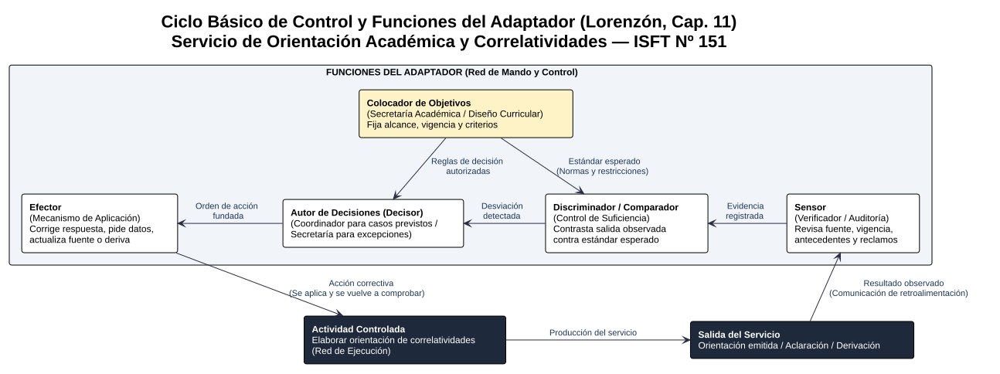
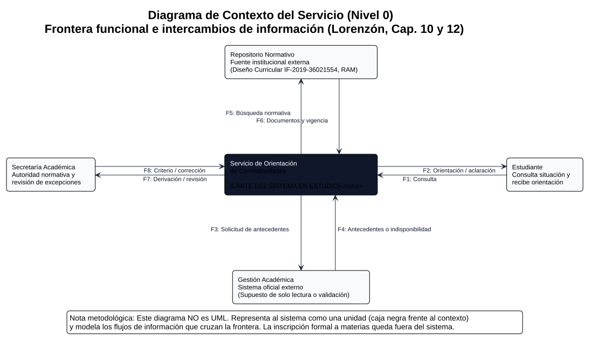
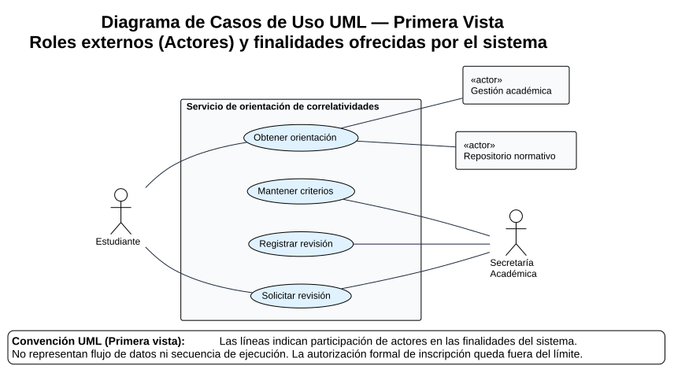

# Clase 13: El Agente de IA como Sistema — Estructura, Control y Primeros Modelos

**Materia:** Sistemas y Organizaciones  
**Carrera:** Tecnicatura Superior en Análisis de Sistemas (ISFT Nº 151)  
**Alumno:** David Hernan Bravo  
**Bibliografía Oficial Aplicada:** Lorenzón, E. E. (2020). *Sistemas y Organizaciones*. EDULP (Parte I: Capítulos 10, 11 y 12; recuperación de Capítulos 7, 8 y 9).  
**Corpus Normativo de Referencia:** Diseño Curricular `IF-2019-36021554-GDEBA-CPEYTDGCYE` (DGCyE Provincia de Buenos Aires).  

---

## 1. Revisión y Evolución del Modelo de la Clase 12

A partir de la resolución orientadora de la cátedra y de la incorporación de los capítulos 10, 11 y 12 de Lorenzón, se revisa críticamente la producción de la Clase 12 para transformar definiciones preliminares en decisiones verificables de diseño:

### 1.1. Matriz de Revisión Sistémica

| Eje Analítico | Estado en Clase 12 (Versión Preliminar) | Evolución en Clase 13 (Modelo Revisado y Justificado) |
| :--- | :--- | :--- |
| **Problema y Evidencia** | Se describió la dispersión normativa (Diseño Curricular, RAM, calendario) como un hecho dado que genera demoras y errores de inscripción. | Se distingue entre **observación**, **hipótesis causal** y **decisión** (Lorenzón, Cap. 12, pp. 166-168): la existencia de múltiples documentos e inconsistencias terminológicas (ej. *"Programación II"* vs. *"Algoritmos y Estructuras de Datos II"* en págs. 8 y 9 del Diseño Curricular) es un **hecho observado**; que esa dispersión cause las demoras es una **hipótesis causal** que requiere relevar consultas anonimizadas, entrevistas y tiempos de atención en Preceptoría. |
| **Objetivo Verificable** | Orientar sobre correlatividades y cursada indicando fuente y vigencia, absteniéndose ante dudas. | Producir una orientación verificable que identifique explícitamente **plan (`IF-2019-36021554`), unidad curricular, requisito correlativo, fuente documental con vigencia y estado de los antecedentes**, o emitir una **derivación fundada** (con motivo y destinatario) cuando no se pueda concluir. La inscripción formal permanece fuera del sistema. |
| **Frontera** | Definida por componentes técnicos (interfaz, prompt, corpus, buscador y módulo de control). | Se define funcionalmente como el **Servicio de orientación de correlatividades**. **Dentro:** interfaz, coordinación de la consulta, recuperación documental, contraste de requisitos, elaboración de respuesta y registro de revisión. **Fuera:** Estudiante, Secretaría Académica, Sistema de Gestión Académica oficial y Repositorio Normativo institucional. |
| **Área Gris Resuelta (Supuesto Explícito)** | Se optó inicialmente por que el estudiante declare sus materias aprobadas para evitar costos de integración. | Para alinear el análisis con el modelo de referencia de la cátedra, se adopta como **supuesto de diseño a validar** la existencia de una **consulta autorizada y de solo lectura al Sistema de Gestión Académica** (flujos `F3` y `F4`). *Plan de contingencia del modelo:* si el relevamiento técnico confirma que no hay permiso o interfaz de lectura al sistema oficial, se eliminan `F3-F4`, los antecedentes pasan a ingresar por `F1` (declarados por el estudiante) y se reduce el grado de certeza declarado en `F2`. |
| **Contexto de Interés** | Mezclaba actores con documentos (Plan de estudios, Calendario). | Se depura conceptualmente: el contexto de interés está integrado por **entidades/sistemas externos** (**Estudiante**, **Secretaría Académica**, **Sistema de Gestión Académica** y **Repositorio Normativo Institucional**). El plan de estudios y el calendario no son actores que toman decisiones, sino **información** que circula desde esas fuentes. |
| **Sinergia y Recursividad** | Explicadas como la unión del modelo de IA con el corpus y su división en tres subsistemas. | **Sinergia:** Una regla vigente sin los antecedentes del alumno no resuelve el caso; los antecedentes sin la regla tampoco. El valor emerge del cruce controlado entre ambos y su explicación trazable. **Recursividad:** El sistema institucional de orientación (metasistema) contiene al Servicio de Orientación (sistema); dentro de este, el *Subsistema de Recuperación y Contraste* posee entradas, transformación, salidas y controles propios alineados con el objetivo global. |
| **Perturbaciones y Feedback** | Listado de 4 perturbaciones y retroalimentación genérica hacia el prompt. | Cada perturbación tiene una conducta reglada en el flujo de control. Se explicita que **guardar comentarios no cierra el ciclo de control ni reentrena automáticamente al modelo de IA**: Secretaría debe emitir una corrección fundada (`F8`), un responsable debe aplicarla y luego comprobar su efecto ejecutando un nuevo caso de prueba. |
|  |  |  |

### 1.2. Tres Mejoras Concretas Incorporadas respecto de la Clase 12

1. **Precisión en la procedencia y permisos de los flujos de entrada:** En la Clase 12 se indicaba genéricamente *"se consultan datos y reglamentos"*. Ahora se especifican los flujos `F3-F4` (consulta de antecedentes académicos de solo lectura y su señal de indisponibilidad) y `F5-F6` (búsqueda y recuperación de reglas con metadatos de vigencia desde el Repositorio Normativo externo).

2. **Formalización del circuito de derivación y revisión humana:** En la Clase 12 el modelo terminaba en *"derivar a Secretaría"*. En la Clase 13 se modela el circuito completo mediante `F7` (envío de derivación/revisión con motivo, síntesis y evidencia) y `F8` (retorno del criterio institucional aprobado o corrección fundada desde Secretaría hacia el servicio).

3. **Separación entre red de ejecución y red de control (Ciclo del Adaptador):** Se dejó de tratar al control como un simple paso final del prompt y se lo modeló cibernéticamente con sus seis elementos (actividad controlada, sensor, colocador de objetivos, discriminador/comparador, decisor y efector).

### 1.3. Cinco Preguntas de Investigación que Siguen Abiertas

1. **Certificación normativa:** ¿Qué autoridad o área específica del ISFT Nº 151 certifica cuál es la versión vigente de una disposición o tabla de correlatividades dentro del repositorio institucional antes de habilitar su uso?

2. **Permisos y factibilidad de acceso:** ¿Qué datos exactos del legajo del estudiante podría consultar el servicio en modo de solo lectura y bajo qué mecanismo de autorización o privacidad institucional?

3. **Protocolo de atención de derivaciones:** ¿Quién recibe operativamente en Secretaría Académica o Preceptoría las derivaciones (`F7`) generadas por el agente y cómo se confirma su recepción y resolución (`F8`)?

4. **Criterio de evaluación de calidad:** ¿Qué evidencia empírica y qué métricas permitirán evaluar que una orientación emitida por el agente fue correcta, clara y útil para el estudiante?

5. **Política de retención y auditoría:** ¿Qué registros mínimos de consultas, fuentes utilizadas y revisiones se conservarán para auditar el funcionamiento del sistema sin exponer datos personales sensibles?

---

## 2. Estructura y Organización del Sistema (Capítulo 10)

Siguiendo a **Emilio Lorenzón (Cap. 10, pp. 121-124)**, todo sistema presenta dos tipos de restricciones ("ataduras") que determinan su comportamiento y deben distinguirse analíticamente:

* **La Estructura:** Es la parte estática o esqueleto en un momento dado; refiere a los componentes del sistema y a las interrelaciones estables (acoplamientos y conexiones) que mantienen entre sí y con el contexto (Lorenzón, p. 122).

* **La Organización:** Es la dimensión funcional; refiere al conjunto de reglas, normas y restricciones operativas que regulan cómo interactúan esos componentes sobre la estructura para alcanzar el objetivo y conservar la identidad del sistema (Lorenzón, pp. 122-123).

> **Analogía aplicada al caso (Lorenzón, p. 123):** Así como en un sistema vial las rutas constituyen la *estructura* y el código de tránsito constituye la *organización*, en nuestro agente la conexión entre la interfaz, el buscador documental y el generador forma la **estructura**; pero exigir que el agente solo responda citando documentos vigentes y derive toda excepción a Secretaría constituye su **organización**. Si mantuviéramos los mismos módulos conectados pero permitiéramos responder con reglamentos sin fecha de vigencia, la estructura permanecería intacta pero cambiaría la organización (degradando la confiabilidad del servicio).

### 2.1. Estructura Funcional del Servicio (Responsabilidades Internas)

Al abrir la caja negra del **Servicio de orientación de correlatividades**, identificamos cuatro módulos o responsabilidades funcionales internas:

1. **Interfaz:** Recibe la consulta del estudiante (`F1`) y presenta la orientación fundamentada, los pedidos de aclaración o el aviso de derivación (`F2`).

2. **Coordinación:** Conserva el estado de la consulta (*«recibida»*, *«requiere datos»*, *«lista para orientar»*, *«derivada»* o *«revisada»*) y decide el próximo paso permitido dentro de las reglas del servicio.

3. **Recuperación y Contraste:** Obtiene la información autorizada desde el Repositorio Normativo (`F5-F6`) y los antecedentes desde Gestión Académica (`F3-F4`), verificando la vigencia de las reglas, la suficiencia de los datos y el cumplimiento de las correlatividades.

4. **Respuesta y Revisión:** Elabora la explicación trazable para el estudiante, registra la evidencia utilizada en el caso y procesa la aplicación de correcciones validadas por Secretaría Académica (`F8`).

* **Puente con la investigación sobre Agentes de IA (Anthropic, 2024):** La simple presencia de un modelo de lenguaje no convierte al sistema en un agente. Un recorrido rígido y único sería un flujo predefinido (*workflow*). El comportamiento de **agente acotado** radica en la responsabilidad de **Coordinación**: evaluar dinámicamente el estado de la consulta para decidir si debe pedir una aclaración al alumno, consultar una fuente autorizada o disparar una derivación a Secretaría, operando siempre dentro de límites organizacionales explícitos.

### 2.2. Acoplamientos, Flujos y Conexiones (Lorenzón, pp. 125-131)

Por el tipo de flujo que procesa (recibe información y emite información), el servicio se clasifica en la matriz de Lorenzón (p. 127, Fig. 10.4) como un **Sistema de procesamiento de información**. Sus relaciones internas se estructuran mediante los siguientes acoplamientos y conexiones:

| Relación entre Componentes | Tipo de Acoplamiento (pp. 125-126) | Tipo de Conexión por Datos y Recorrido (pp. 128-131) | Flujo (Qué circula) | Consecuencia en la Red Causal a estudiar |
| :--- | :--- | :--- | :--- | :--- |
| **Interfaz → Coordinación** | En serie | Secuencial / Simple externa | Consulta normalizada (materia, plan, intención). | Si la interfaz o normalización identifica mal la materia (ej. confunde *Análisis Matemático I* con *II*), el error se propaga en cadena a toda la búsqueda posterior. |
| **Coordinación → Recuperación** (Normativa y Antecedentes) | En paralelo | De comunicación (fuente compartida) / Simple externa | Solicitud acotada de regla vigente y estado de materias previas. | La fuente normativa es compartida por múltiples funciones; una desactualización o inconsistencia en el repositorio afecta simultáneamente a todas las consultas de esa carrera. |
| **Recuperación y Contraste → Coordinación** | En serie | **Conexión que afecta al flujo de control** | Estado de verificación: *verificable*, *incompleto* o *contradictorio*, junto con regla y vigencia. | **Crítico (Lorenzón, p. 131):** Este dato decide la bifurcación del proceso (responder, pedir datos o derivar). Si un fallo produce una mala respuesta al alumno, mirar solo el texto final oculta si la falla ocurrió al leer la vigencia o al evaluar la suficiencia. |
| **Respuesta y Revisión → Coordinación** | Por retroacción | Compleja / Que afecta al flujo de control | Corrección validada por Secretaría y ajuste de criterio operativo. | Cierra el bucle correctivo (red tipo *Red*, Fig. 10.3), modificando la conducta del sistema para casos similares posteriores. |
|  |  |  |  |  |

### 2.3. Tres Reglas Funcionales de Organización

Para sostener el objetivo del sistema sin perder su identidad (Lorenzón, pp. 123-124 y 142), la organización impone tres reglas funcionales innegociables:

1. **Regla de Exclusividad y Vigencia Documental (R-ORG-01):** Ninguna orientación concluyente puede emitirse sin identificar explícitamente el plan de estudios (`IF-2019-36021554-GDEBA-CPEYTDGCYE`), la unidad curricular, el documento fuente y su vigencia aprobada.

2. **Regla de Suficiencia y No Inferencia de Antecedentes (R-ORG-02):** Ante la falta de datos sobre el estado de una materia correlativa (ya sea por omisión del estudiante o por indisponibilidad del sistema académico), el servicio tiene prohibido suponer su aprobación o desaprobación; debe declarar la información como *insuficiente* e informar qué requisito no pudo verificarse.

3. **Regla de Reserva Institucional y Derivación (R-ORG-03):** Toda situación que involucre normas contradictorias, equivalencias externas, pases o excepciones reglamentarias detiene la conclusión automática y se deriva obligatoriamente a Secretaría Académica, única autoridad con potestad resolutiva.

### 2.4. Niveles de Desagregación, Cohesión y Variables (Lorenzón, pp. 125 y 132-134)

Aplicando un diseño *Top-Down* con **bajo grado de conexión entre subsistemas y alta cohesión interna** (para que cada módulo tenga una única responsabilidad clara y los errores no se propaguen caóticamente, Lorenzón, pp. 132-133), desagregamos el universo en seis niveles jerárquicos, mostrando en detalle dos niveles internos del sistema:

* **Metasistema:** Sistema Institucional de Gestión y Orientación Académica del ISFT Nº 151.

* **Sistema:** Servicio de orientación de correlatividades con agente de IA.

  * **Nivel de Desagregación 1 — Subsistema:** *Subsistema de Recuperación y Contraste de Requisitos* (posee sinergia y cohesión interna propias: recibe la consulta acotada, cruza normas con antecedentes y devuelve un dictamen de verificación).

  * **Nivel de Desagregación 2 — Proceso:** *Proceso de contraste de correlatividades para acreditación/cursada* (ej. verificar si el estudiante cumple las condiciones de la página 9 del Diseño Curricular para *Prácticas Profesionalizantes II*).

    * **Actividad:** Comprobar cada requisito correlativo exigido por la asignatura objetivo (ej. comprobar requisito 1: *Prácticas Profesionalizantes I*; comprobar requisito 2: *Sistemas y Organizaciones*).

    * **Tarea:** Comparar el estado registrado del antecedente del alumno (`Aprobado` / `Regular` / `Sin cursar` / `No disponible`) contra la condición exigida por la regla (`Deberá tener aprobado`).

**Comportamiento dinámico de los elementos del proceso (Lorenzón, pp. 133-134):**

* **Variables:** El estado particular de cada materia antecedente del estudiante que cambia entre consulta y consulta.

* **Parámetros:** La tabla de correlatividades vigente del Diseño Curricular `IF-2019-36021554-GDEBA-CPEYTDGCYE`, que permanece fija e inactiva (constante) durante el procesamiento de una consulta normal, pero que puede transformarse en variable cuando ocurre una reforma curricular.

* **Operadores:** El indicador de estado emitido por el contraste (*«incompleto»* o *«excepción detectada»*), que actúa como variable líder o pivote activando al proceso de derivación o de solicitud de aclaración.

### 2.5. Red de Ejecución vs. Red de Mando y Control (Lorenzón, pp. 135-137)

* **Red de Ejecución (Operativa):** Integrada por la secuencia operativa que transforma la entrada en el servicio: recibir la consulta en *Interfaz*, buscar la norma y los antecedentes en *Recuperación*, cruzar las condiciones en *Contraste* y redactar el texto explicativo en *Respuesta*.

* **Red de Mando y Control (Reguladora):** Opera mediante flujos de control ascendentes y descendentes bajo un **esquema organizacional jerárquico** (Lorenzón, p. 137, Fig. 10.15):

  * *Control local (descentralizado en Coordinación):* Decide autónomamente acciones operativas acotadas, como pedirle al estudiante que aclare a qué año o materia se refiere cuando la entrada es ambigua.

  * *Control superior (centralizado en Secretaría Académica):* Reserva para la autoridad humana la definición de políticas, la validación de vigencia normativa y la resolución de excepciones. Así se evita que el componente que ejecuta la respuesta pueda alterar por sí mismo la regla con la que se evalúa su desempeño.

---

## 3. El Control en el Sistema y Ciclo Básico (Capítulo 11)

En términos cibernéticos (**Lorenzón, Cap. 11, pp. 144-147**), que el agente responda rápido y con redacción fluida no significa que esté controlado. La **información es control** (Wiener) porque actúa como una corriente **neguentrópica**: impone restricciones, obstruye la variedad de interpretaciones erróneas y limita los grados de libertad del generador de texto para mantener al sistema dentro de su **dominio de estabilidad o meseta homeoquinética** (Lorenzón, pp. 147 y 150-151).

### 3.1. Especificación del Ciclo Básico de Control (El Adaptador)

Para regular la salida principal del sistema (**la orientación de correlatividades emitida al estudiante**), definimos las seis funciones que componen el **Adaptador** (Lorenzón, pp. 152-154, Fig. 11.3):

| Unidad del Ciclo Básico | Aplicación al Servicio de Orientación (ISFT Nº 151) | Estándar / Evidencia Observable |
| :--- | :--- | :--- |
| **1. Actividad controlada** | Proceso de elaboración de la orientación sobre correlatividades de la Tecnicatura. | Texto de la respuesta emitida (`F2`) y registro de la consulta que la originó (`F1`). |
| **2. Colocador de objetivos** | **Responsable Institucional (Secretaría Académica)** que fija el alcance, las reglas aprobadas y los criterios de validez. | **Estándar esperado:** *Toda orientación concluyente debe poseer plan identificado, fuente normativa vigente citada y antecedentes suficientes verificados; de lo contrario, debe pedir datos o derivar.* |
| **3. Sensor** | Mecanismo mixto: verificación automática de metadatos (fuente, fecha y presencia de antecedentes) + recepción de reportes/revisiones humanas (`F7/F8`). | Registro de comprobaciones del caso y alerta o devolución recibida sobre una respuesta emitida. |
| **4. Discriminador (Comparador)** | Contrasta el resultado observado por el sensor contra el estándar fijado por el colocador de objetivos. | **Desviación detectada:** Por ejemplo, detectar que se intentó responder con un documento sin vigencia verificada, con datos de legajo faltantes o ante una equivalencia no reglada. |
| **5. Autor de decisiones (Decisor)** | Distribuido jerárquicamente (Lorenzón, pp. 154-160): **Coordinación** para desvíos operativos previstos; **Secretaría Académica** para excepciones y correcciones de criterio. | Decisión fundada de: (a) bloquear conclusión y pedir datos, (b) derivar el caso a Secretaría, o (c) aprobar un ajuste normativo en el servicio. |
| **6. Efector** | Mecanismo que ejecuta la acción correctiva sobre la actividad controlada. | Retiro o reemplazo del documento desactualizado, incorporación del criterio aclaratorio (ej. equivalencia terminológica *"Programación II"* = *"Algoritmos y Estructuras de Datos II"*), emisión de la respuesta corregida y **nueva ejecución de prueba para comprobar el ajuste**. |
|  |  |  |

> **Criterio de cierre del bucle (Lorenzón, pp. 153-157):** Emitir una alerta o guardar un reclamo en una bandeja que nadie revisa no completa el ciclo de control. De acuerdo con el principio de coordinación del control (p. 157), la corrección debe aplicarse sobre la actividad y **volver a comprobarse mediante un caso de prueba** que verifique que la desviación desapareció.

### 3.2. Análisis de la Variable Tiempo: Retraso vs. Rezago (Lorenzón, pp. 148-150)

El tiempo de respuesta del sistema de control es crítico para su estabilidad (Fig. 11.2):

* **Retraso (Delay):** Tiempo que transcurre desde que se produce una perturbación hasta que el sistema **comienza a reaccionar**.

  * *Ejemplo en nuestro caso:* El Consejo Provincial o la Secretaría Académica emite una disposición modificando una pauta de inscripción o aclarando una correlatividad antes del llamado a finales, pero el administrador tarda 10 días en enterarse y cargarla en el Repositorio Normativo. Durante esos 10 días el sistema sufre un *retraso*: sigue respondiendo con la regla vieja de forma completa y errónea. Si la corrección se aplica después de cerrada la inscripción, el control fue conceptualmente correcto pero **operativamente inútil (tardío)**.

* **Rezago (Lag):** Tiempo que toma el sistema en alcanzar el **impacto total** de una corrección una vez que la acción ya comenzó (amortiguación progresiva).

  * *Ejemplo en nuestro caso:* Secretaría envía la corrección (`F8`) hoy mismo y se actualiza el documento maestro, pero debido a cachés de búsqueda, copias locales desincronizadas o revisiones pendientes de casos ya derivados en cola, la actualización tarda varias horas o días en verse reflejada en la totalidad de las consultas activas.

### 3.3. Resolución Paso a Paso de una Perturbación Concreta

* **Perturbación / Hallazgo (Sensor):** En una prueba de revisión sobre correlatividades de 3.º año (*Algoritmos y Estructuras de Datos III*), se detecta que una respuesta preliminar usó una copia documental sin la nota aclaratoria institucional sobre el nombre *"Programación II"* que figura en la página 9 del Diseño Curricular.

* **Comparación (Discriminador):** Incumple el estándar de vigencia y consistencia terminológica aprobado por Secretaría.

* **Decisión (Autor de decisiones):** Suspender la orientación concluyente para ese cruce y solicitar intervención del responsable para fijar la regla de equivalencia de nombres.

* **Acción Correctiva (Efector):** Retirar la fuente ambigua, registrar el criterio oficial aprobado por Secretaría (`"Programación II" en pág. 9 equivale a "Algoritmos y Estructuras de Datos II" de pág. 8`) y corregir la orientación afectada.

* **Verificación de cierre:** Repetir la consulta con un caso de prueba para 3.º año, comprobar que el servicio aplica la regla validada y dejar constancia en el registro de revisiones.

---

## 4. Modelo de Contexto y Diccionario de Flujos

Siguiendo las pautas de desagregación de primer nivel de **Lorenzón (Cap. 10, pp. 138-139, Fig. 10.18)** y de formalización de **Cap. 12 (pp. 170-172)**, el Diagrama de Contexto representa al **Servicio de orientación de correlatividades** como una única unidad central (ocultando sus módulos internos) y explicita los flujos de información que cruzan su frontera hacia y desde las cuatro entidades externas de su contexto de interés:

### 4.1. Diccionario de Intercambios (Flujos `F1` a `F8`)

| Código y Nombre del Flujo | Origen → Destino | Contenido Específico y Condición de Control |
| :--- | :--- | :--- |
| **F1 · Consulta** | Estudiante → Servicio | Unidad curricular consultada, año/plan de estudios y datos mínimos autorizados para identificar la situación académica a evaluar. |
| **F2 · Orientación / aclaración** | Servicio → Estudiante | Explicación verificable de requisitos cumplidos o pendientes, cita de fuente y vigencia, y límites del servicio (o bien pedido de aclaración de datos / aviso de que el caso fue derivado). |
| **F3 · Solicitud de antecedentes** | Servicio → Gestión académica | Consulta acotada al estudiante autorizado para verificar el estado de las materias correlativas involucradas. *Condición:* operación estricta de **solo lectura** (no modifica registros). |
| **F4 · Antecedentes o indisponibilidad** | Gestión académica → Servicio | Estado académico registrado de las materias consultadas (`Aprobada`, `Regular`, `Pendiente`) con fecha del registro, o señal explícita de **indisponibilidad técnica/falta de datos**. No incluye autorización de inscripción. |
| **F5 · Búsqueda normativa** | Servicio → Repositorio normativo | Parámetros de búsqueda: carrera (`TS en Análisis de Sistemas`), plan (`IF-2019-36021554`), unidad curricular y período para recuperar la regla aplicable. |
| **F6 · Documentos y vigencia** | Repositorio normativo → Servicio | Reglas de correlatividad, régimen académico y metadatos obligatorios de fuente y vigencia aprobada (o resultado vacío si no existe norma cargada). |
| **F7 · Derivación / revisión** | Servicio → Secretaría Académica | Escalamiento formal de un caso que excede el alcance automático: incluye motivo de la derivación (excepción, contradicción o vacío), síntesis de la consulta y evidencia recolectada. |
| **F8 · Criterio / corrección** | Secretaría Académica → Servicio | Devolución institucional fundada sobre un caso en revisión y/o actualización de criterios operativos aprobados para mantener la validez del servicio. |
|  |  |  |

### 4.2. Supuestos de Acceso, Información Excluida y Defensa de la Frontera

* **Supuestos de acceso declarados:** Se asume para este modelo que el servicio cuenta con: (1) permiso de lectura acotada sobre los antecedentes en el sistema de Gestión Académica (`F3-F4`) y (2) acceso a un Repositorio Normativo cuyas versiones ya fueron visadas institucionalmente (`F5-F6`). Ambos supuestos deben verificarse en el relevamiento real antes de pasar a la construcción.

* **Información y acciones que quedan estrictamente fuera de la frontera:** No existen flujos para asentar inscripciones a materias, inscribir a finales, modificar calificaciones en actas ni sancionar nuevas resoluciones normativas. Esas responsabilidades pertenecen a los sistemas oficiales y autoridades del metasistema.

* **Por qué esta frontera es defendible:** Aunque Secretaría Académica y el Repositorio Normativo pertenecen al ISFT Nº 151, son **externos al sistema informático de orientación** que estamos diseñando (no están dentro de nuestro dominio de cambios de software). El proveedor tecnológico del LLM tampoco se dibuja aquí porque esta es una vista funcional del servicio (si en etapas futuras se audita el tráfico de red hacia servidores en la nube, se representará en una vista de despliegue/infraestructura).

---

## 5. Primer Acercamiento a UML: Vista de Casos de Uso (Capítulo 12)

De acuerdo con **Lorenzón (Cap. 12, pp. 173-175)**, ningún sistema complejo puede comprenderse con un único diagrama: se requieren vistas complementarias que mantengan coherencia entre sí. Mientras el Diagrama de Contexto muestra *qué información circula* a través de la frontera, el **Diagrama de Casos de Uso UML** responde: **¿qué roles externos (actores) interactúan con el sistema y para qué finalidades de valor?**

### 5.1. Actores y Alcance de los Casos de Uso

Manteniendo exactamente la misma frontera del Diagrama de Contexto (`Servicio de orientación de correlatividades`), identificamos dos actores humanos (**Estudiante** y **Secretaría Académica**) y dos actores de sistema o de apoyo (**«actor» Gestión académica** y **«actor» Repositorio normativo**), vinculados a cuatro casos de uso principales:

1. **CU-01 · Obtener orientación:** Permite al Estudiante consultar y recibir una explicación fundamentada sobre las correlatividades y requisitos de una materia, apoyándose en la consulta a Gestión académica y al Repositorio normativo.

2. **CU-02 · Solicitar revisión:** Permite canalizar un caso que no puede resolverse automáticamente (por excepción, contradicción o reclamo fundado del Estudiante) hacia Secretaría Académica para su intervención.

3. **CU-03 · Registrar revisión:** Permite a Secretaría Académica incorporar al servicio la devolución fundada o resolución de un caso revisado para actualizar su estado e informar al Estudiante.

4. **CU-04 · Mantener criterios:** Permite a Secretaría Académica registrar o actualizar los criterios operativos aprobados (por ejemplo, reglas de equivalencia terminológica o vigencia de documentos) bajo los cuales opera el servicio.

### 5.2. Especificación Detallada: `CU-01 Obtener orientación`

| Campo | Descripción |
| :--- | :--- |
| **Caso de Uso** | **CU-01 · Obtener orientación** |
| **Actor Principal** | Estudiante (ISFT Nº 151). |
| **Actores de Apoyo** | `«actor» Gestión académica` y `«actor» Repositorio normativo`. |
| **Disparador (Trigger)** | El estudiante solicita conocer si cumple los requisitos correlativos para cursar o acreditar una unidad curricular del plan de estudios. |
| **Precondiciones** | La consulta pertenece al alcance de orientación académica de la carrera y el servicio dispone de permiso activo para consultar las fuentes normativas y los antecedentes requeridos. |
| **Flujo Normal (Secuencia Principal)** | 1. El estudiante indica la unidad curricular de interés (ej. *Ingeniería de Software I* o *Algoritmos y Estructuras de Datos III*) y el plan de estudios. 2. El servicio solicita los antecedentes permitidos a `Gestión académica` y recupera la regla de correlatividad aplicable desde el `Repositorio normativo`. 3. El servicio comprueba la correspondencia del plan (`IF-2019-36021554`), la vigencia de la fuente y la suficiencia de los antecedentes recibidos. 4. El servicio contrasta cada requisito correlativo exigido por la norma contra el estado de las materias previas del estudiante. 5. El servicio devuelve al estudiante la orientación fundamentada (detallando requisitos cumplidos, pendientes y fuente citada) y registra la evidencia de la verificación. |
| **Resultado Esperado (Postcondición)** | El estudiante recibe una explicación verificable sobre su situación frente a la materia consultada y las limitaciones del servicio (aclarando que no constituye inscripción formal). No se modifica su legajo académico. |
| **Flujos Alternativos y Excepciones** | • **A1 (Datos iniciales incompletos):** Si el estudiante no indica qué materia o plan consulta (ej. dice solo *"¿Qué puedo rendir?"*), el servicio solicita que precise la asignatura antes de buscar. • **A2 (Antecedente no disponible o falla de acceso):** Si `Gestión académica` informa indisponibilidad o no consta el estado de una correlativa, el servicio no concluye: informa exactamente qué requisito no pudo verificarse. • **A3 (Contradicción normativa o caso excepcional):** Si el estudiante plantea una equivalencia externa, pase o existe contradicción documental, el servicio suspende la conclusión y habilita el paso a **Solicitar revisión (CU-02)** hacia Secretaría Académica. |
|  |  |

### 5.3. Tabla de Coherencia entre Diagrama de Contexto y Casos de Uso UML

| Flujos del Diagrama de Contexto | Caso de Uso UML Asociado | Regla de Coherencia entre Vistas |
| :--- | :--- | :--- |
| **F1, F2, F3, F4, F5 y F6** | `Obtener orientación` | Los flujos de entrada/salida con el Estudiante (`F1-F2`) y las consultas a los dos sistemas externos de apoyo (`F3-F6`) instrumentan la finalidad principal del estudiante. |
| **F1, F2 y F7** | `Solicitar revisión` | Cuando un caso requiere intervención humana, se envía el paquete de derivación con motivo y evidencia a Secretaría (`F7`) y se notifica el estado al estudiante (`F2`). |
| **F8 (y eventual F2)** | `Registrar revisión` | La devolución fundada de Secretaría ingresa por `F8`, actualiza el estado del caso revisado y permite comunicar la respuesta corregida al estudiante por `F2`. |
| **F8** | `Mantener criterios` | Los criterios operativos que regulan al agente ingresan exclusivamente desde Secretaría Académica (`F8`), preservando la autoridad institucional. |
|  |  |  |

### 5.4. Justificación Epistemológica y Metodológica (Lorenzón, Cap. 12)

1. **Modelos mentales, filtros y ambientes (pp. 163-169):** Como analistas no accedemos a la realidad de forma neutra, sino a través de *filtros perceptivos* e *interpretativos* (formación técnica, experiencia). Lorenzón advirtió en la introducción del capítulo (p. 162) sobre el peligro del *"filtro cultural informático"*: creer que cualquier problema organizacional se resuelve inyectando código o inteligencia artificial sin entender las reglas del negocio. Para evitarlo, filtramos el universo desde el **Ambiente Potencial** (todas las carreras, reformas futuras, proveedores de IA) y el **Ambiente Operativo** (las cursadas actuales del ISFT Nº 151), pasando por el **Ambiente Percibido** (la dispersión documental y el error de nombre *"Programación II"* en la pág. 9 del Diseño Curricular) y el **Ambiente Inferido** (la hipótesis de que esto genera sobrecarga en Preceptoría), hasta recortar el **Ambiente Valorizado** (Fig. 12.3, p. 167), que define el alcance exacto de nuestro sistema.

2. **Qué muestra y qué omite cada vista formal (Abstracción y Precisión, pp. 169-175):** Toda abstracción generaliza para hacer manejable un problema complejo, pero al mismo tiempo *"empobrece la realidad"* al omitir detalles (p. 169). Por eso combinamos vistas con distinto propósito y nivel de abstracción (p. 174):

   * El **Diagrama de Contexto** muestra la frontera, los sistemas externos y la dirección/contenido de los flujos de datos (`F1-F8`), pero **omite** las metas funcionales de los usuarios, el orden temporal de los pasos y la arquitectura interna.

   * El **Diagrama de Casos de Uso UML** muestra qué actores participan y qué finalidades de valor les brinda el sistema (mediante líneas de asociación sin flecha que indican participación, no flujo de datos), pero **omite** la secuencia interna de ejecución y las estructuras de datos (que se detallan en la especificación textual de `CU-01` y en futuros diagramas de secuencia).

3. **Compromiso entre Complejidad y Error (pp. 178-181):** Según la curva de *Complejidad vs. Error* (Fig. 12.7, p. 180), un modelo nunca tiene error cero porque no es la realidad misma; sin embargo, no hace falta inflar la complejidad dibujando decenas de pantallas antes de tiempo. Reducimos el error del modelo seleccionando con precisión los componentes críticos (como el retorno de control `F8` y el verificador de vigencia) y sometiendo el modelo a **contraste experimental** (p. 179), recordando que el control real siempre actúa sobre la realidad institucional y no solo sobre el papel (Fig. 12.8, p. 181).

---

## 6. Recorrido de Escenarios, Contraste y Observaciones Audiovisuales

Para contrastar en escritorio la coherencia entre la estructura, el ciclo de control, el diagrama de contexto y los casos de uso UML (Lorenzón, Cap. 12, p. 179), probamos tres escenarios utilizando una regla del Diseño Curricular `IF-2019-36021554-GDEBA-CPEYTDGCYE` con datos de prueba ficticios:

* **Regla de prueba (`R-DC-01`):** Según la tabla de correlatividades del Diseño Curricular (pág. 9), para acreditar **«Ingeniería en Software I»** (2.º año) se requiere tener aprobada **«Sistemas y Organizaciones»** (1.º año). Se asume versión vigente `V-2019` validada por Secretaría en el Repositorio Normativo.

* **Criterio de salida controlada:** Solo se emite orientación concluyente si el plan coincide, la norma `V-2019` está vigente y el estado de *Sistemas y Organizaciones* está disponible y verificado.

### 6.1. Matriz de Prueba de Escenarios

| Escenario y Datos de Prueba | Recorrido por Flujos, Estructura y Control | Resultado Esperado del Servicio |
| :--- | :--- | :--- |
| **1. Escenario Normal** *Estudiante ficticio #01* consulta si cumple correlativas para *Ingeniería en Software I* (Plan `IF-2019-36021554`). En Gestión Académica consta *Sistemas y Organizaciones = Aprobada*. | • Inicia `CU-01` por `F1`. • *Coordinación* solicita en paralelo `F3` (antecedentes) y `F5` (norma). • Ingresan `F4` (*Sistemas y Organizaciones: Aprobada*) y `F6` (Regla pág. 9 vigente). • *Recuperación y Contraste* verifica cumplimiento; el *Sensor/Comparador* valida que se cumple el estándar de suficiencia y vigencia. | **Orientación concluyente por `F2`:** *"Con los datos verificados en el Plan IF-2019-36021554 (pág. 9, versión vigente), cumplís el requisito correlativo (Sistemas y Organizaciones aprobada) para acreditar Ingeniería en Software I. Recordá que la inscripción formal debe realizarse por los canales oficiales del instituto."* |
| **2. Escenario Incompleto (Datos faltantes)** *Estudiante ficticio #02* realiza la misma consulta, pero `Gestión académica` devuelve señal de indisponibilidad o el estado de *Sistemas y Organizaciones* no figura cargado. | • Inicia `CU-01` por `F1`; `F5-F6` recuperan la regla vigente, pero `F4` informa *antecedente no disponible*. • La conexión hacia *Coordinación* modifica el flujo de control. • El *Comparador* detecta que no se alcanza el estándar de suficiencia; el *Decisor* (Coordinación) aplica la regla `R-ORG-02` (prohibido inferir o equiparar falta de datos con desaprobación). | **Orientación acotada sin conclusión por `F2`:** *"Según el Diseño Curricular IF-2019-36021554 (pág. 9), Ingeniería en Software I exige tener aprobada Sistemas y Organizaciones. Actualmente no puedo determinar si cumplís el requisito porque no está disponible el estado de esa materia en los registros consultados."* |
| **3. Escenario Excepcional** *Estudiante ficticio #03* consulta por *Ingeniería en Software I* indicando que aprobó una materia homónima en otra universidad y presentó un trámite de equivalencia externa aún en evaluación. | • Inicia por `F1`. Al detectar la condición de *equivalencia externa no resuelta*, el *Comparador* identifica que el caso excede las reglas estándar (`R-ORG-03`). • Se activa `CU-02 (Solicitar revisión)`: *Coordinación* suspende toda inferencia y el *Efector* emite `F7` a Secretaría Académica con el motivo y la síntesis del caso, avisando al alumno por `F2`. • Cuando Secretaría resuelve y envía `F8` (`CU-03 Registrar revisión`), se actualiza el estado del caso. | **Suspensión y derivación trazable (`F2` + `F7`):** *"Tu consulta involucra una equivalencia externa en trámite, cuya resolución corresponde exclusivamente a Secretaría Académica. Se suspendió la conclusión automática y se registró la solicitud de revisión ante Secretaría para su evaluación oficial."* |
|  |  |  |

* **¿Qué permitió detectar y ajustar este recorrido?** El contraste con los escenarios 2 y 3 demostró que si el flujo `F4` solo admitiera valores booleanos (`Aprobado / Desaprobado`), el sistema confundiría un fallo de red o un acta pendiente de carga con una materia desaprobada. Gracias al recorrido, se incorporó explícitamente el estado *«indisponibilidad / dato faltante»* en `F4` y el circuito `F7-F8` para las revisiones.

### 6.2. Observaciones de los Recursos Audiovisuales Aplicadas a Nuestros Diagramas

1. **Sobre el video de Diagrama de Contexto (Fatto Consultoría y Sistemas, 2016):**

   * *Observación aplicada:* El video enfatiza que las flechas que cruzan la frontera no deben rotularse con sustantivos vagos como *"datos"*, *"información"* o *"parámetros"*, sino con paquetes de información con significado de negocio claro. Aplicamos este criterio al erradicar flechas genéricas y definir con precisión flujos como `F4 · Antecedentes o indisponibilidad` y `F6 · Documentos y vigencia`, lo cual se fundamenta en **Lorenzón (Cap. 10, pp. 138-139)** al especificar los datos exactos que ingresan y egresan entre el sistema en estudio y los almacenes/actores del contexto.

2. **Sobre el video de Casos de Uso UML (Garrido Tejero - Universitat Politècnica de València, 2022):**

   * *Observación aplicada:* El autor distingue rigurosamente entre un *caso de uso* (un proceso completo que aporta un resultado de valor observable para un actor) y los *insumos de datos* o *pasos elementales de interfaz* (como *"abrir pantalla"*, *"leer PDF"* o *"documentos vigentes"*). Aplicamos esto al modelar `Obtener orientación` como la finalidad del estudiante, ubicando al `Repositorio normativo` como un actor secundario de apoyo y no como un caso de uso. Esto responde directamente a **Lorenzón (Cap. 12, pp. 173-175)** respecto a no mezclar la vista de flujos de datos con la vista funcional orientada a objetos/actores de UML.

---

## 7. Fundamentación Teórica por Capítulo (Secuencia: Concepto → Decisión → Consecuencia)

Siguiendo la estructura argumentativa exigida por la cátedra (*Concepto → Decisión del caso → Consecuencia → Página de referencia*):

* **Capítulo 10 (Estructura y Organización):**

  1. *Estructura vs. Organización:* La distinción entre la red de relaciones estables entre componentes (estructura) y las restricciones funcionales que guían la conducta hacia el objetivo (organización) nos llevó a la **decisión** de separar el acoplamiento técnico entre el recuperador documental y el generador respecto de la regla funcional `R-ORG-01` (obligación de verificar vigencia normativa antes de responder); como **consecuencia**, el instituto puede actualizar criterios de vigencia o reemplazar documentos sin necesidad de rediseñar la estructura modular del software (**Lorenzón, Cap. 10, pp. 121–124**).

  2. *Conexiones que afectan al flujo de control y Cohesión:* El reconocimiento de que ciertas conexiones transfieren datos que alteran las decisiones de control y complejizan la red causal fundamentó la **decisión** de desagregar el servicio aislando un módulo específico de *Recuperación y Contraste* con alta cohesión interna que entrega un estado explícito (*verificable, incompleto o contradictorio*) a *Coordinación*; como **consecuencia**, si se detecta una orientación errónea, podemos auditar exactamente si el fallo ocurrió en la lectura del documento o en la generación del texto, evitando la propagación incontrolada de errores (**Lorenzón, Cap. 10, pp. 128–133**).

  3. *Red de ejecución y Red de mando jerárquica:* La diferenciación entre procesos ejecutores y procesos supervisores sustentó la **decisión** de adoptar un esquema organizacional jerárquico donde *Coordinación* resuelve aclaraciones operativas locales, pero Secretaría Académica retiene el mando sobre excepciones y normas; como **consecuencia**, el agente mantiene agilidad operativa sin adquirir jamás la potestad de autorizar inscripciones ni cambiar sus propias reglas de evaluación, preservando la identidad del sistema (**Lorenzón, Cap. 10, pp. 135–137 y 142**).

* **Capítulo 11 (El Control en los Sistemas):**

  1. *Información como neguentropía y Variedad Requerida:* El principio cibernético de que la información reduce la entropía al obstruir la variedad y que el controlador debe igualar la variedad de estados del sistema justificó la **decisión** de ampliar el repertorio de salidas de control más allá de *"cumple / no cumple"*, agregando los estados *"pedir datos"*, *"informar indisponibilidad"* y *"derivar a Secretaría"*; como **consecuencia**, el sistema conserva su elasticidad y permanece dentro de su dominio de estabilidad (meseta homeoquinética) frente a consultas incompletas o caídas de fuentes sin inventar respuestas (**Lorenzón, Cap. 11, pp. 146–148 y 150–152**).

  2. *Ciclo Básico de Control (Adaptador) y Tiempo de Respuesta (Retraso/Rezago):* La estructura del *Adaptador* (sensor, colocador de objetivos, discriminador, decisor y efector) y el efecto desestabilizante de los retrasos fundamentaron la **decisión** de exigir que toda corrección enviada por Secretaría (`F8`) sea aplicada por un responsable y comprobada en un nuevo caso de prueba antes de las fechas críticas de inscripción; como **consecuencia**, se evita que las alertas queden sin efecto práctico o que una actualización normativa actúe con retraso cuando el período de inscripción ya cerró (**Lorenzón, Cap. 11, pp. 148–150 y 152–157**).

* **Capítulo 12 (El Modelo como Estructura del Razonamiento):**

  1. *Filtros del observador y Ambientes de percepción:* El análisis de cómo los modelos mentales y los filtros perceptivos/culturales condicionan el recorte de la realidad fundamentó la **decisión** de separar los hechos observados en el Diseño Curricular (como las inconsistencias de nombres en la pág. 9) respecto de las hipótesis causales y de explicitar el supuesto de acceso de solo lectura a Gestión Académica (`F3-F4`); como **consecuencia**, si el relevamiento empírico demuestra que dicha conexión técnica no está disponible en el instituto, sabemos exactamente qué parte del modelo formal debemos ajustar (reemplazar `F3-F4` por declaración del alumno en `F1` y acotar el alcance de `CU-01`) sin que el proyecto fracase por supuestos ocultos (**Lorenzón, Cap. 12, pp. 162–169 y 178–181**).

  2. *Vistas complementarias en el modelado formal (Contexto y UML):* El principio de que ningún modelo único agota la realidad y que cada vista abstrae un aspecto específico manteniendo correspondencia con el sistema real justificó la **decisión** de construir en paralelo el Diagrama de Contexto y el Diagrama de Casos de Uso UML sobre una misma frontera; como **consecuencia**, logramos comunicar sin ambigüedades tanto el intercambio de flujos de datos (`F1-F8`) como las finalidades funcionales de cada actor (`CU-01` a `CU-04`), manteniendo una complejidad reducida y un rango de error controlado (**Lorenzón, Cap. 12, pp. 170–175 y 179–180**).

---

## 8. Referencias Bibliográficas y Documentales

* **Lorenzón, E. E.** (2020). *Sistemas y Organizaciones*. Editorial de la Universidad Nacional de La Plata (EDULP).

  * *Parte I, Capítulo 7:* El Sistema y su contexto (pp. 84–91).
  * *Parte I, Capítulo 8:* Sinergia y Recursividad (pp. 92–102).
  * *Parte I, Capítulo 9:* Sistema cerrado y abierto (pp. 103–120).
  * *Parte I, Capítulo 10:* La estructura y organización del Sistema (pp. 121–143).
  * *Parte I, Capítulo 11:* El control en los Sistemas (pp. 144–161).
  * *Parte I, Capítulo 12:* El modelo como estructura del razonamiento (pp. 162–181).

* **Dirección General de Cultura y Educación de la Provincia de Buenos Aires [DGCyE]** (2019). *Diseño Curricular de la Tecnicatura Superior en Análisis de Sistemas* (`IF-2019-36021554-GDEBA-CPEYTDGCYE`).

* **Anthropic** (2024). *Building effective agents*. Documentación técnica sobre flujos predefinidos y agentes de IA.

* **Fatto Consultoría y Sistemas** (2016). *Diagrama de Contexto* [Recurso audiovisual citado en Clase 13].

* **Garrido Tejero, A. — Universitat Politècnica de València [UPV]** (2021/2022). *Casos de uso y diagramas de casos de uso* [Recurso audiovisual citado en Clase 13].