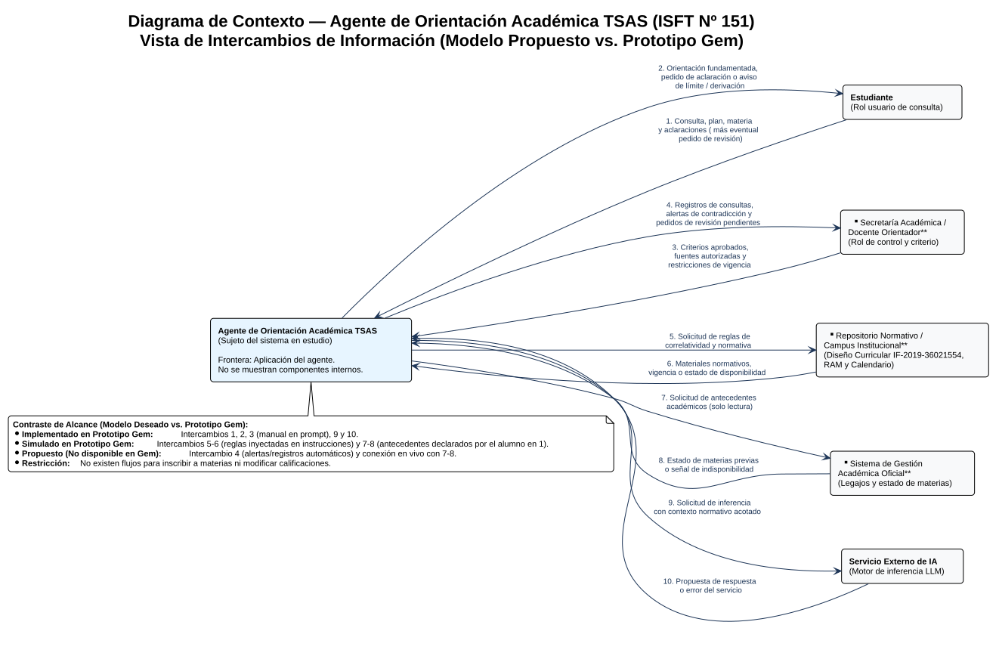
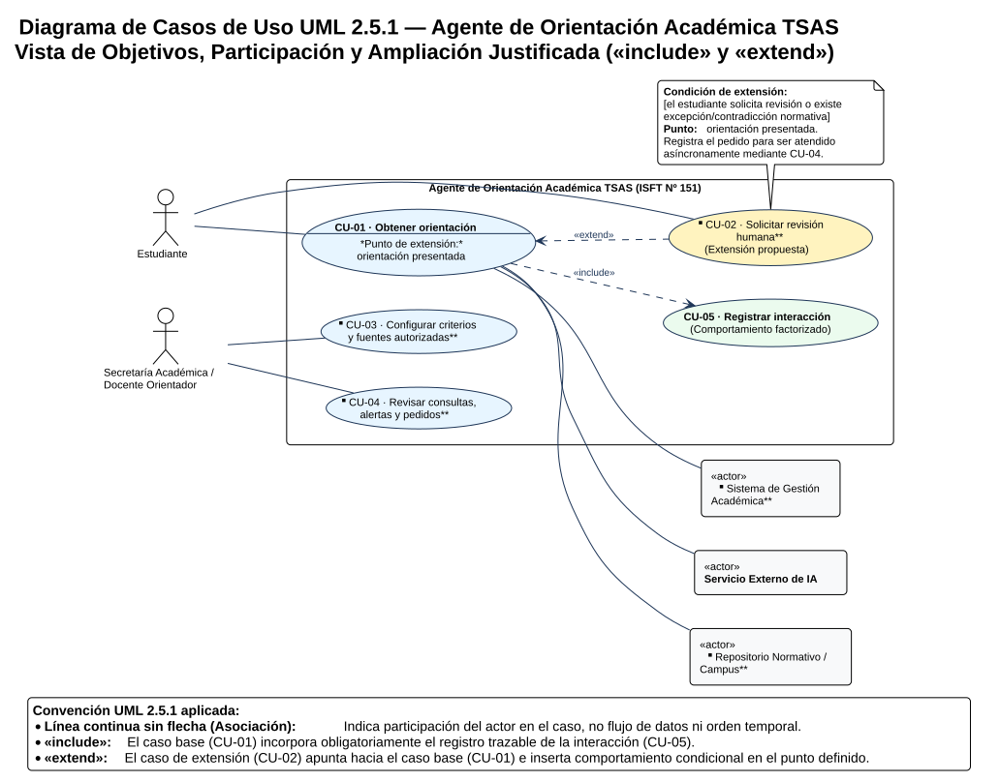

# Clase del 25 de Septiembre: Del Agente de IA a sus Diagramas — Contexto y Casos de Uso UML Paso a Paso

**Materia:** Sistemas y Organizaciones  
**Carrera:** Tecnicatura Superior en Análisis de Sistemas (ISFT Nº 151)  
**Alumno:** David Hernan Bravo  
**Bibliografía Oficial Aplicada:** Lorenzón, E. E. (2020). *Sistemas y Organizaciones*. EDULP (Parte I: Capítulos 7, 10, 12 y 13; Parte II: Capítulo 5 - Procesos) y OMG (2017). *Unified Modeling Language (UML) Version 2.5.1* (Cap. 18: Use Cases).  
**Corpus Normativo del Caso:** Diseño Curricular de la Tecnicatura Superior en Análisis de Sistemas (`IF-2019-36021554-GDEBA-CPEYTDGCYE`).  

---

## 0. Apertura y Reflexión sobre el Video: *Modelos de Sistemas y UML*

### 0.1. Frase rectora del proyecto (Antes de modelar)

> **«Nuestro agente ayuda a los estudiantes de la Tecnicatura Superior en Análisis de Sistemas del ISFT Nº 151 a lograr comprender de forma verificable qué requisitos de correlatividad y cursada cumplen o tienen pendientes según el Diseño Curricular oficial, sin reemplazar las decisiones administrativas de Secretaría Académica.»**

### 0.2. Cuatro observaciones clave del recurso audiovisual aplicadas al proyecto

1. **Qué muestra un modelo y qué deja fuera (Abstracción):** Todo modelo formal (Lorenzón, Cap. 12, pp. 170-175) es un recorte intencional que selecciona las relaciones relevantes para un propósito y omite el resto. Ningún diagrama único sirve para todo: intentar dibujar flujos de datos, pantallas, secuencias temporales y objetivos en el mismo gráfico destruye su legibilidad.

2. **Distinción entre Participante, Intercambio y Función:**

   * *Participante (Entidad externa / Actor):* Rol humano o sistema autónomo situado fuera de la frontera (`Estudiante`, `Secretaría Académica / Docente Orientador`, `Servicio Externo de IA`).

   * *Intercambio (Flujo de datos):* Paquete de información que cruza la frontera en un sentido determinado (`Consulta y materias declaradas`, `Propuesta de inferencia`).

   * *Función / Objetivo (Caso de uso):* Comportamiento del sistema que produce un resultado observable de valor para un actor (`Obtener orientación`).

3. **Qué debe verse en el Contexto vs. en los Casos de Uso:** En el **Diagrama de Contexto** el sistema es una caja única central rodeada por entidades externas conectadas con flechas rotuladas con sustantivos de información (entradas y salidas). En el **Diagrama de Casos de Uso UML** se abre la vista funcional para mostrar qué objetivos persigue cada actor mediante elipses conectadas con líneas de asociación sin punta de flecha (participación).

4. **Pregunta registrada para la puesta en común:** *¿Cómo mantenemos la trazabilidad documental en el repositorio cuando el modelo deseado incluye actores de apoyo externos (`Repositorio Normativo`, `Gestión Académica`) que en el prototipo actual de Gemini Gems todavía están simulados dentro del prompt?* (Resuelta en la sección 4.3 de esta entrega).

---

## 1. Ficha Consolidada del Proyecto y Delimitación del Problema

Siguiendo la estructura de taller de la **Sección 12** de la clase, se presenta la ficha técnica completa del proyecto integrador:

| Campo de la Ficha | Definición Aplicada al Proyecto (`AGENTE_IA`) |
| :--- | :--- |
| **1. Proyecto y autor** | **Agente de Orientación Académica TSAS (ISFT Nº 151)** — Desarrollo individual: David Hernan Bravo. |
| **2. Problema y evidencia** | **Problema:** Los estudiantes de 1.º, 2.º y 3.º año de la Tecnicatura Superior en Análisis de Sistemas enfrentan incertidumbre y errores de interpretación al verificar qué unidades curriculares pueden cursar o acreditar, debido a que las reglas están repartidas entre el Diseño Curricular (`IF-2019-36021554-GDEBA-CPEYTDGCYE`), el Régimen Académico Marco y el calendario institucional, presentando incluso inconsistencias internas en el documento ministerial (como exigir *"Programación II"* en la tabla de correlatividades de la pág. 9 cuando la materia se denomina *"Algoritmos y Estructuras de Datos II"* en las págs. 8 y 20). **Evidencia disponible vs. a relevar:** Se cuenta con la evidencia documental directa de las inconsistencias del Diseño Curricular oficial; resta relevar empíricamente muestras anonimizadas de consultas frecuentes y tiempos de respuesta en Preceptoría/Secretaría durante las semanas de inscripción. |
| **3. Objetivo verificable** | Brindar orientación fundamentada y trazable sobre el cumplimiento de correlatividades y condiciones de cursada de las 22 unidades curriculares del plan `IF-2019-36021554`, identificando explícitamente fuente, página y vigencia, solicitando aclaraciones ante datos incompletos y registrando/derivando hacia Secretaría Académica toda excepción o contradicción normativa. |
| **4. Dentro / Fuera de la frontera y justificación** | **Dentro de la aplicación del agente:** Interfaz conversacional de consulta, coordinación y validación de suficiencia, aplicación de criterios y reglas de equivalencia terminológica, preparación de orientaciones con citas y gestión interna del registro de consultas/alertas. **Fuera de la frontera:** `Estudiante`, `Secretaría Académica / Docente Orientador`, `Repositorio Normativo / Campus Institucional`, `Sistema de Gestión Académica Oficial` y `Servicio Externo de IA` (proveedor del modelo LLM). **Fuera del alcance funcional (Prohibido):** Inscribir formalmente a materias o finales, alterar notas o legajos, sancionar normativas o autorizar excepciones. **Justificación:** Se traza la frontera sobre la *aplicación del agente* (Lorenzón, Cap. 7, dominio de cambios). Hacer visible al `Servicio Externo de IA` fuera de la frontera permite modelar explícitamente qué ocurre cuando el proveedor externo falla o propone una respuesta que contradice la fuente oficial. |
| **5. Entidades, entradas y salidas** | Desarrolladas en detalle en la Tabla 2.1 (cinco entidades externas con sus flujos de entrada y salida desglosados). |
| **6. Objetivos de uso y actores** | • **CU-01 · Obtener orientación** (Actor principal: `Estudiante`; Apoyos: `Servicio Externo de IA`, `Repositorio Normativo`, `Gestión Académica`). • **CU-02 · Solicitar revisión humana** (Actor principal: `Estudiante`; extiende a `CU-01`). • **CU-03 · Configurar criterios y fuentes autorizadas** (Actor principal: `Secretaría Académica / Docente Orientador`). • **CU-04 · Revisar consultas, alertas y pedidos** (Actor principal: `Secretaría Académica / Docente Orientador`). • **CU-05 · Registrar interacción** (Caso incluido obligatoriamente por `CU-01`). |
| **7. Caso principal (resumen)** | `CU-01` inicia cuando el estudiante envía su consulta indicando materia y antecedentes; el agente verifica suficiencia y alcance, obtiene la norma aplicable del Diseño Curricular y los antecedentes, solicita la inferencia acotada al servicio de IA, controla que la propuesta no contradiga la fuente, presenta la orientación con referencias y registra la interacción (`CU-05`). *Excepción clave:* si la propuesta del LLM contradice la tabla de correlatividades (`5a`), el agente bloquea la respuesta, informa el límite al alumno y genera una alerta para revisión humana. |
| **8. Decisión del sistema vs. Decisión humana** | **El sistema decide:** Comprobar si faltan datos en la pregunta, pedir aclaración (ej. distinguir *cursada* de *aprobada*), seleccionar el fragmento normativo, bloquear propuestas sin respaldo y registrar alertas. **La persona (Secretaría / Docente) decide:** Aprobar qué documentos y criterios están vigentes (`CU-03`), auditar las alertas registradas (`CU-04`), resolver equivalencias externas o inscripciones de mayores de 25 años y ejecutar la inscripción oficial fuera del sistema. |
| **9. Implementado / Simulado / Propuesto** | • **Implementado hoy (Prototipo Gem):** Diálogo con el estudiante, validación de suficiencia, distinción cursada/aprobada, equivalencia *"Programación II" = "Algoritmos II"*, recomendación de acudir a Secretaría e inferencia sobre Gemini. • **Simulado hoy:** El acceso al Repositorio Normativo (las reglas están copiadas dentro del prompt del Gem) y la lectura de antecedentes (los declara el propio estudiante). • **Propuesto (Modelo objetivo):** Consulta automática de solo lectura a Gestión Académica y al Repositorio institucional, base interna de auditoría de alertas (`CU-04`) y registro formal de pedidos de revisión (`CU-02`). |
| **10. Tres decisiones justificadas** | 1. **Externalizar al `Servicio Externo de IA` en el contexto:** Permite diseñar controles de validación post-inferencia (`paso 5`) y prever la caída del proveedor (`excepción 4a`). 2. **Ocultar la base de registros dentro de la frontera:** El registro de auditoría pertenece a la solución del agente; dibujarlo como entidad externa violaría el nivel de abstracción del contexto. 3. **Modelar `Solicitar revisión humana` con `«extend»` y `Registrar interacción` con `«include»`:** Porque el registro ocurre siempre que se completa la orientación, mientras que el pedido de revisión solo se inserta condicionalmente en el punto *orientación presentada*. |
| **11. Corrección realizada y duda pendiente** | **Corrección realizada respecto de la Clase 13:** En la Clase 13 habíamos ocultado al proveedor de IA y habíamos conectado directamente a Secretaría con el caso de uso de revisión sincrónica; ahora incorporamos al `Servicio Externo de IA` como actor de apoyo y desacoplamos la solicitud de revisión del estudiante (`CU-02`) respecto de la auditoría diferida del docente/secretaría (`CU-04`). **Duda pendiente:** Definir si en la versión final para la cátedra se mantendrá únicamente el corpus normativo inyectado en el prompt o si se anexará un archivo Markdown depurado en la sección *Conocimiento* del Gem. |
|  |  |

---

## 2. La Vista de los Intercambios: Diagrama de Contexto y Variantes

### 2.1. Tabla de Entidades e Intercambios (Paso previo al dibujo)

Siguiendo el método de los 7 pasos de la **Sección 04**, identificamos quién envía información al agente (**Entrada**) y quién recibe información desde el agente (**Salida**). Recordamos la regla metodológica: *la dirección de la flecha indica quién envía el dato, no quién se beneficia de la operación* (por eso una búsqueda hacia el repositorio es una **salida** del agente, y el documento devuelto es una **entrada**).

| Entidad Externa | Entidad → Agente (Corriente de Entrada) | Agente → Entidad (Corriente de Salida) |
| :--- | :--- | :--- |
| **1. Estudiante** | Consulta académica (materia a cursar/rendir, plan), antecedentes declarados, aclaraciones solicitadas y eventual pedido de revisión humana. | Orientación fundamentada con referencias (plan, página, vigencia), pedido de aclaración de datos o aviso de límite de alcance / derivación. |
| **2. Secretaría Académica / Docente Orientador** | Criterios operativos aprobados, reglas de equivalencia terminológica, fuentes autorizadas y restricciones de vigencia. | Registros de interacciones, alertas por contradicciones o vacíos normativos y listado de pedidos de revisión pendientes. |
| **3. Repositorio Normativo / Campus Institucional** | Materiales normativos vigentes (Diseño Curricular `IF-2019-36021554`, RAM, calendario) o señal de estado/no disponibilidad. | Solicitud o búsqueda acotada de reglas de correlatividad y condiciones por materia y año. |
| **4. Sistema de Gestión Académica Oficial** | Estado registrado de las materias correlativas del estudiante (`Aprobada`, `Regular`, `Pendiente`) o señal de indisponibilidad. | Solicitud de lectura de antecedentes académicos del estudiante autorizado (estrictamente solo lectura). |
| **5. Servicio Externo de IA** | Propuesta de respuesta generada por el modelo o mensaje de error / falla de disponibilidad del servicio. | Solicitud de inferencia (prompt ensamblado con la consulta validada, los criterios docentes y los fragmentos normativos). |
|  |  |  |

### 2.2. Diagrama de Contexto del Agente

### 2.3. Justificación de Decisiones de Frontera y Análisis de Variantes (Sección 05)

1. **Decisión sobre una frontera dudosa (¿El `Servicio Externo de IA` va dentro o fuera?):**

   En la Clase 13 habíamos adoptado una vista puramente de negocio donde el motor de IA quedaba implícito dentro del servicio. En esta clase adoptamos la decisión arquitectónica de **ubicar al `Servicio Externo de IA` como entidad externa** en el contexto. *Justificación (Lorenzón, Cap. 7 y 10):* Nuestro agente no es dueño ni entrena el modelo neuronal subyacente, sino que lo consume como un servicio externo. Hacerlo visible fuera de la frontera del agente permite distinguir claramente entre *la propuesta en crudo que devuelve el LLM* y *la orientación controlada que el agente le entrega al estudiante* luego de verificar que no haya alucinaciones ni contradicciones con el Diseño Curricular.

2. **Por qué la base de datos de registros/alertas NO se dibuja en el contexto:**

   El almacén donde el agente guarda el historial de consultas y alertas (`CU-05`) es un componente interno de nuestra aplicación. Dibujarlo fuera como un cilindro violaría la regla de abstracción del Diagrama de Contexto (mezclando el Nivel 0 con una descomposición interna DFD Nivel 1).

3. **Resolución de los errores frecuentes de contexto evitados:**

   * No se dibujan flechas directas entre `Estudiante` y `Secretaría Académica` (aunque hablen en la vida real, eso ocurre en el metasistema fuera de nuestro software).

   * No se usan rótulos vagos como *"Datos"*, *"Usa"* o *"HTTPS"* (HTTPS es el protocolo técnico de transporte, no la información funcional que se intercambia).

   * No se usan flechas bidireccionales con un solo nombre: cada par solicitud/respuesta tiene dos flechas separadas con sentido inequívoco.

---

## 3. La Vista de los Objetivos: Casos de Uso UML y Especificación Completa

### 3.1. Identificación de Objetivos por Actor (Separando Objetivo, Dato y Paso Técnico)

Aplicando los pasos de la **Sección 06**, evitamos convertir datos (*"Consulta"*, *"Plan de estudios"*) o pasos técnicos elementales (*"Hacer clic en enviar"*, *"Llamar a la API de Gemini"*, *"Responder en menos de 3 segundos"*) en elipses de casos de uso. Formulamos objetivos que entregan un **resultado observable de valor**:

| Actor Principal | Necesidad / Meta del Actor | Caso de Uso Propuesto en el Sistema | Actores de Apoyo que Participan |
| :--- | :--- | :--- | :--- |
| **Estudiante** | Comprender si cumple las correlatividades y requisitos para cursar o acreditar una materia de la carrera. | **CU-01 · Obtener orientación** *(incluye obligatoriamente a `CU-05 · Registrar interacción`)*. | `Servicio Externo de IA`, `Repositorio Normativo / Campus` y `Sistema de Gestión Académica`. |
| **Estudiante** | Dejar asentado un pedido de intervención humana cuando su caso presenta una excepción o duda sobre la orientación recibida. | **CU-02 · Solicitar revisión humana** *(extiende condicionalmente a `CU-01` en el punto «orientación presentada»)*. | *(Registra el pedido internamente para ser revisado luego en `CU-04`)*. |
| **Secretaría Académica / Docente Orientador** | Definir bajo qué reglas, equivalencias terminológicas y documentos vigentes debe responder el agente. | **CU-03 · Configurar criterios y fuentes autorizadas**. | Ninguno. |
| **Secretaría Académica / Docente Orientador** | Auditar qué consultan los alumnos, qué fallas o contradicciones se detectaron y atender los pedidos de revisión. | **CU-04 · Revisar consultas, alertas y pedidos**. | Ninguno. |
|  |  |  |  |

### 3.2. Diagrama de Casos de Uso UML 2.5.1 (Con `«include»` y `«extend»` Justificados)

#### Justificación técnica de las relaciones UML empleadas (Sección 08):

* **Asociación (línea continua sin puntas de flecha):** Conecta a `Estudiante`, `Docente/Secretaría` y los tres sistemas externos con los casos en los que participan. No tiene flecha porque en UML 2.5.1 la asociación indica *participación en el objetivo*, no dirección de flujo de datos. Además, `Secretaría / Docente` no se asocia con `CU-01` porque no interviene en vivo cada vez que un estudiante hace una pregunta.

* **Relación `«include»` (`CU-01` $\dashrightarrow$ `CU-05 Registrar interacción`):** La flecha discontinua con punta abierta sale del caso base (`CU-01`) y apunta hacia el caso incluido (`CU-05`). Se justifica porque registrar la consulta, la fuente utilizada y el resultado es una obligación de trazabilidad institucional que forma parte integral del éxito de la orientación y se reutiliza como insumo para la auditoría docente (`CU-04`).

* **Relación `«extend»` (`CU-02 Solicitar revisión humana` $\dashrightarrow$ `CU-01`):** La flecha discontinua con punta abierta sale de la extensión (`CU-02`) y apunta hacia el caso base (`CU-01`). `CU-01` es completo y válido por sí mismo; solo si se cumple la condición `[el estudiante solicita revisión o surge una excepción normativa]` en el **punto de extensión:** *orientación presentada*, se inserta el comportamiento de `CU-02` para dejar registrado el pedido.

* **¿Por qué no agregamos Generalización en el diagrama principal?** Porque tanto los ingresantes de 1.º año como los estudiantes avanzados de 2.º y 3.º año persiguen el mismo objetivo (`Obtener orientación`) bajo las mismas reglas de validación; cambiar la materia consultada (*Álgebra* vs. *Prácticas Profesionalizantes III*) constituye distintos **escenarios** del mismo caso de uso `CU-01`, por lo que crear sub-elipses especializadas solo agregaría ruido visual sin aportar comportamiento diferente.

---

### 3.3. Especificación Completa del Caso Principal: `CU-01 Obtener orientación`

Siguiendo la plantilla exhaustiva de la **Sección 07** de la clase:

| Atributo | Especificación para `CU-01 Obtener orientación` |
| :--- | :--- |
| **Objetivo** | Recibir una orientación verificable y trazable sobre el cumplimiento de correlatividades o condiciones de una unidad curricular basada en el Diseño Curricular `IF-2019-36021554-GDEBA-CPEYTDGCYE`, o comprender con exactitud por qué no es posible concluir automáticamente. |
| **Alcance** | Aplicación del Agente de Orientación Académica TSAS (ISFT Nº 151); nivel de objetivo del usuario. |
| **Actor Principal** | `Estudiante`. |
| **Actores de Apoyo** | `Servicio Externo de IA`, `Repositorio Normativo / Campus Institucional` y `Sistema de Gestión Académica Oficial` (cuando se consultan normas y antecedentes). |
| **Disparador** | El estudiante envía una consulta sobre correlatividades o requisitos de cursada/acreditación. |
| **Precondiciones** | Existen criterios operativos y fuentes normativas autorizadas configuradas previamente mediante `CU-03`. *(Nota: no se dibuja «Iniciar sesión» como `«include»` porque contar con acceso habilitado es una precondición, no un objetivo funcional que se repita en cada pregunta).* |
| **Garantía Mínima (Postcondición de fallo)** | El sistema comunica con claridad el estado de la consulta y **jamás presenta como fundamentada o concluyente una orientación que no pueda sostener con las fuentes vigentes y antecedentes verificados**, ni altera registros oficiales. |
| **Resultado de Éxito (Postcondición de éxito)** | El estudiante recibe la orientación fundamentada con cita explícita del Diseño Curricular (página y vigencia) y las limitaciones de alcance, quedando la interacción registrada mediante `CU-05` para posterior revisión en `CU-04`. |
|  |  |

#### Flujo Principal (Escenario feliz sin dificultades):

1. El **Estudiante** envía la consulta indicando la unidad curricular de interés (ej. *Algoritmos y Estructuras de Datos III* o *Ingeniería en Software I*) y su situación respecto de las materias previas.

2. El **Agente** comprueba que la consulta contenga los datos mínimos necesarios (carrera/plan, materia objetivo y condición de aprobación de las correlativas) y que se encuentre dentro del alcance de orientación académica.

3. El **Agente** selecciona las reglas aplicables; en el modelo completo solicita el fragmento correspondiente al **Repositorio Normativo** y verifica los antecedentes en **Gestión Académica**, recibiendo la tabla de correlatividades vigente (pág. 9 del `IF-2019-36021554`) y los estados requeridos.

4. El **Agente** ensambla la solicitud de inferencia con los criterios de control y solicita al **Servicio Externo de IA** una propuesta de explicación.

5. El **Servicio Externo de IA** devuelve la propuesta. El **Agente** ejecuta sus controles de validación (verifica que cite la regla vigente, que respete la equivalencia *"Programación II" = "Algoritmos y Estructuras de Datos II"* y que no autorice inscripciones) y prepara la orientación definitiva.

6. El **Agente** presenta la orientación fundamentada y las referencias normativas al **Estudiante** *(Punto de extensión: `orientación presentada`)*.

7. El **Agente** ejecuta el comportamiento incluido **`CU-05 · Registrar interacción`**, guardando la traza de la consulta para revisión docente, y concluye el caso.

#### Flujos Alternativos y Excepciones (Ligados a cada paso del Flujo Principal):

| Paso | Situación / Condición | Respuesta del Sistema y Continuidad del Caso |
| :---: | :--- | :--- |
| **2a** | **Consulta incompleta o ambigua** *(ej. el alumno dice «cursé Sistemas y Organizaciones» sin aclarar si aprobó el final, o no indica qué materia quiere cursar)*. | El agente no asume aprobación ni desaprobación: explica la diferencia entre *cursar* y *aprobar* y solicita el dato faltante. Si el estudiante lo aporta, regresa al paso **2**; si abandona la sesión, finaliza sin orientación concluyente. |
| **2b** | **Pregunta fuera del alcance** *(ej. pide que el agente lo inscriba a una mesa de examen, reclama una nota de acta o plantea una equivalencia externa / ingreso de mayor de 25 años)*. | El agente explica explícitamente su límite funcional, informa que el trámite requiere intervención de **Secretaría Académica / Preceptoría** y habilita la opción de registrar el pedido (`CU-02`). Finaliza con resultado limitado controlando el alcance. |
| **3a** | **Fuente normativa ya disponible localmente en el agente** *(escenario del prototipo actual con reglas pre-cargadas)*. | El agente utiliza la regla autorizada ya cargada en su configuración y continúa directamente en el paso **4** sin realizar una petición externa al repositorio. |
| **3b** | **Material normativo o antecedente inaccesible / insuficiente** *(caída del repositorio/sistema académico o materia no encontrada en la tabla)*. | El agente intenta usar su copia normativa autorizada si existe; si falta el antecedente o la regla no consta, informa qué elemento exacto no pudo verificarse, se abstiene de concluir y finaliza registrando la incidencia. |
| **4a** | **El Servicio Externo de IA no responde o devuelve error técnico** *(caída de API o límite de cuota)*. | El agente informa la indisponibilidad temporal del servicio al estudiante y habilita reintentar más tarde o consultar por los canales de Preceptoría. **Jamás inventa ni simula una respuesta sin validación.** |
| **5a** | **La propuesta del modelo de IA contradice las fuentes o incumple reglas** *(ej. el LLM ignora una correlativa de la pág. 9 o afirma que el alumno ya quedó inscripto)*. | El control interno rechaza presentar esa propuesta como orientación válida, informa el límite al estudiante y registra una **alerta prioritaria** en `CU-05` para que el docente/secretaría la audite en `CU-04`. |
| **6a** | **El estudiante solicita revisión humana tras leer la orientación** *(Condición de `«extend»` en el punto `orientación presentada`)*. | Se inserta el caso extendido **`CU-02 · Solicitar revisión humana`**, registrando el motivo de duda o excepción para atención diferida por Secretaría Académica, y luego continúa al paso **7**. |
| **7a** | **Falla en el guardado del registro interno (`CU-05`)**. | El agente no declara éxito administrativo completo: entrega la advertencia correspondiente y aplica la política de contingencia definida en el proyecto. |
|  |  |  |

* **Requisitos no funcionales / de calidad asociados al comportamiento (sin crear falsos casos de uso):**

  1. *Fidelidad documental (Grounding):* 100% de las respuestas concluyentes deben mencionar el código `IF-2019-36021554-GDEBA-CPEYTDGCYE` y la página de referencia.

  2. *Tiempo de respuesta:* Respuesta interactiva menor a 10 segundos en condiciones normales de red.

  3. *Privacidad y minimización de datos:* No almacenar credenciales ni datos sensibles ajenos a la consulta curricular.

---

## 4. Conexión de Vistas: Proceso con Responsables, Trazabilidad y Contraste con el Prototipo

### 4.1. Guion del Proceso de Principio a Fin con Responsables (Sección 10 y Lorenzón Parte II, Cap. 5)

Para conectar la vista estática de objetivos con la dinámica de ejecución, recorremos el proceso asignando qué actor o sistema es responsable de cada acción y decisión:

| Paso | Responsable | Acción y Decisión de Control | Información que Circula (Flujo del Contexto) |
| :---: | :--- | :--- | :--- |
| **1** | **Estudiante** | Plantea una consulta sobre correlatividades o cursada de la carrera. | `1. Consulta, plan y materias declaradas` (Estudiante → Agente). |
| **2** | **Agente** | Evalúa alcance y suficiencia de datos. *Decisión:* ¿Están la materia objetivo y el estado de las correlativas? Si falta algo o dice solo *"cursé"*, pide aclaración y vuelve a evaluar; si excede alcance, detiene inferencia. | `2. Pedido de aclaración` (Agente → Estudiante) $\leftrightarrow$ `1. Aclaraciones` (Estudiante → Agente). |
| **3** | **Agente + Repositorio / Gestión Académica** | Recuperan la regla aplicable del Diseño Curricular y el estado de antecedentes. *Decisión:* ¿Hay fuente vigente y datos disponibles? Si no hay disponibilidad, se activa aviso de limitación (`3b`). | `5 y 7. Solicitud de reglas y antecedentes` $\rightarrow$ `6 y 8. Materiales vigentes / estados o indisponibilidad`. |
| **4** | **Agente + Servicio Externo de IA** | El agente envía el contexto normativo acotado y el servicio de IA genera una propuesta. *Decisión:* Si el proveedor falla (`4a`), se informa indisponibilidad técnica. | `9. Solicitud de inferencia` (Agente → Servicio IA) $\rightarrow$ `10. Propuesta o error` (Servicio IA → Agente). |
| **5** | **Agente** | Contrasta la propuesta con las restricciones de organización (`R-ORG-01` a `03`). Entrega la orientación válida al estudiante (o activa `CU-02` si el alumno pide revisión) y ejecuta `CU-05 (Registrar interacción)`. | `2. Orientación fundamentada / aviso` (Agente → Estudiante) y guardado en registro interno. |
| **6** *(Asíncrono)* | **Secretaría Académica / Docente** | En otro momento (no en vivo durante el chat), revisa alertas y pedidos mediante **`CU-04`** y actualiza criterios o equivalencias mediante **`CU-03`**. | `4. Registros, alertas y pedidos` (Agente → Docente) $\rightarrow$ `3. Criterios y fuentes revisados` (Docente → Agente). |
|  |  |  |  |

### 4.2. Prueba de Trazabilidad entre el Diagrama de Contexto y los Casos de Uso UML

| Intercambio del Diagrama de Contexto | Caso(s) de Uso que lo Utilizan | Comprobación Verificable en el Sistema |
| :--- | :---: | :--- |
| **1 y 2 · Consulta / Orientación y aclaraciones** | `CU-01` y `CU-02` | Ante consulta completa devuelve orientación con cita de `IF-2019-36021554`; ante consulta incompleta pide precisar si aprobó o solo cursó. |
| **3 · Criterios aprobados y fuentes autorizadas** | `CU-03` | Un ajuste en las reglas de equivalencia o vigencia modifica efectivamente el comportamiento de las siguientes consultas en `CU-01`. |
| **4 · Registros, alertas y pedidos pendientes** | `CU-04` (alimentado por `CU-05` y `CU-02`) | El responsable humano puede identificar qué consultas generaron contradicciones o solicitudes de revisión por excepciones. |
| **5, 6, 7 y 8 · Solicitud y recepción de normas y antecedentes** | `CU-01` | Si la regla y el antecedente están disponibles, se contrastan; si alguno falta, el sistema se abstiene de inventar y declara qué dato no pudo verificar. |
| **9 y 10 · Solicitud de inferencia / Propuesta o error** | `CU-01` | El modelo genera el texto explicativo subordinado al prompt; ante falla del servicio externo, no se emite respuesta sin control. |
|  |  |  |

### 4.3. Contraste Honesto con el Prototipo: Implementado vs. Simulado vs. Propuesto

Cumpliendo con el criterio de rigor de la cátedra (*"no presentes como disponible una capacidad que solo figura en el modelo deseado"*), se explicita la correspondencia exacta con nuestro prototipo en **Gemini Gems** ([`prototipo/instrucciones_gem.md`](../prototipo/instrucciones_gem.md)):

| Capacidad / Elemento del Modelo | Estado en el Prototipo Actual (Gemini Gem) | Explicación Técnica de la Diferencia |
| :--- | :---: | :--- |
| **Recepción de consulta, filtro de suficiencia y orientación con cita (`CU-01`, Flujos 1, 2, 9 y 10)** | ✅ **Implementado** | El Gem recibe la consulta del estudiante, distingue *cursada* de *aprobada*, aplica la tabla de la pág. 9 del Diseño Curricular y cita la fuente y vigencia. |
| **Configuración de criterios y reglas por el responsable (`CU-03`, Flujo 3)** | ✅ **Implementado (Manual)** | Se realiza desde el panel de edición de *Instrucciones* del Gestor de Gems de Google Gemini y se comprueba mediante casos de prueba. |
| **Consulta al Repositorio Normativo (`Flujos 5 y 6`)** | 🟡 **Simulado** | El Gem no se conecta en vivo al servidor web del ISFT Nº 151; las reglas del Diseño Curricular `IF-2019-36021554` están inyectadas directamente en las instrucciones del sistema (paso alternativo `3a`). |
| **Consulta de antecedentes en Gestión Académica (`Flujos 7 y 8`)** | 🟡 **Simulado (Por declaración)** | Al no existir integración por API con el sistema de legajos, los antecedentes los declara el estudiante en su mensaje de entrada y el Gem advierte explícitamente que *no están verificados oficialmente*. |
| **Solicitud de revisión (`CU-02`), Registro automático (`CU-05`) y Bandeja de alertas (`CU-04`, Flujo 4)** | 🔵 **Propuesto (Modelo deseado)** | Un Gem estándar de Gemini no posee una base de datos multiusuario accesible para Secretaría ni envía tickets automáticos; hoy el Gem recomienda al alumno acudir a Secretaría (aclarando que no envía el trámite) y la auditoría (`CU-04`) se realiza manualmente durante las sesiones de prueba del analista. |
|  |  |  |

---

## 5. Resolución de Situaciones de Autoevaluación y Desafío Final de Fronteras

Para dejar documentado el dominio completo de los conceptos del encuentro (Sección 13 del material de cátedra), se resuelven y justifican las 8 situaciones problemáticas y el desafío final:

### 5.1. Las 8 Situaciones Resueltas y Justificadas

1. **«El agente usa un archivo de configuración propio. ¿Es una entidad externa?»**

   * *Respuesta:* **No.** Si el archivo de configuración pertenece a la solución del agente y está dentro de su dominio de cambios, es un componente o almacén interno. Solo se dibujaría en el contexto la persona (`Docente / Administrador`) que envía los parámetros de configuración desde afuera.

2. **«La consulta al campus ocurre solo cuando faltan materiales locales. ¿Exige `include` o `extend`?»**
   * *Respuesta:* **Ninguno de los dos en el diagrama.** Es simplemente un paso condicional dentro del texto de especificación del caso de uso `CU-01` (tal como se modeló en el paso `3` y la alternativa `3a`). Extraer una elipse por cada `if/else` técnico convierte el diagrama de casos de uso en un diagrama de flujo de programación.

3. **«El estudiante puede solicitar revisión en "orientación presentada". ¿Hacia dónde apunta `extend`?»**
   * *Respuesta:* La flecha discontinua con estereotipo `«extend»` **sale del caso de extensión (`Solicitar revisión`) y apunta hacia el caso base (`Obtener orientación`)**, indicando en qué punto de extensión se inserta y bajo qué condición.

4. **«Docente coordinador puede hacer todo lo de Docente y una función adicional. ¿Qué relación usarías?»**
   * *Respuesta:* **Generalización de actores** (`Es un tipo de`). Se traza una línea continua desde el actor especializado (`Docente coordinador`) con una punta triangular hueca apuntando hacia el actor general (`Docente`). Así hereda la participación en `CU-03` y `CU-04` y suma su caso exclusivo.

5. **«La IA devuelve un error. ¿Hay que agregar un actor "Error"?»**

   * *Respuesta:* **Jamás.** Un error no es un rol ni un sistema externo: es un resultado posible dentro del flujo de retorno (`Propuesta / error`) proveniente del actor `Servicio Externo de IA`, y se modela como una excepción (`4a` o `5a`) en la especificación del caso de uso.

6. **«¿Una flecha del contexto equivale a un caso de uso?»**

   * *Respuesta:* **No.** No existe relación 1 a 1: una flecha del contexto representa un paquete de datos que cruza la frontera, mientras que un caso de uso representa un objetivo de valor completo que suele requerir múltiples flechas de entrada y salida (`F1` a `F10`) para concretarse.

7. **«El prototipo solo es un chat con documentos cargados manualmente. ¿Qué corregís?»**

   * *Respuesta:* Corregimos la correspondencia entre el modelo implementado y el propuesto: en la vista del prototipo real eliminamos la entidad `Campus / Repositorio` (porque no hay consulta entre sistemas), hacemos que los documentos ingresen desde el `Docente / Analista` al configurar el asistente y aclaramos que los antecedentes son declarados por el usuario.

8. **«¿"Iniciar sesión" debe incluirse siempre desde cada caso?»**

   * *Respuesta:* **No.** Haber iniciado sesión o estar autenticado se declara como una **precondición** de los casos de uso que lo requieran. Usar `«include»` desde todos los casos hacia *Iniciar sesión* es un error clásico que confunde una precondición de estado con una sub-función ejecutada repetidamente en cada operación.

### 5.2. Desafío Final: Comparación de las Variantes A y B y Síntesis Estructural

* **Variante A (Modelo de IA interno + materiales cargados manualmente por el docente/secretaría):**

  * *Participantes que desaparecen del contexto:* Desaparecen como entidades externas tanto el **`Servicio Externo de IA`** (porque la inferencia pasa a ser un proceso interno dentro de la frontera del sistema) como el **`Repositorio Normativo / Campus`** (porque no hay integración automática entre sistemas).

  * *Participantes que permanecen:* `Estudiante` y `Secretaría Académica / Docente Orientador`.

  * *Flujos que cambian:* Se eliminan los flujos `5, 6, 9 y 10`; el flujo `3` desde el `Docente` pasa a incluir directamente la carga manual de los documentos normativos junto con los criterios.

* **Variante B (Proveedor de IA externo + Repositorio normativo externo):**

  * *Participantes y flujos:* Permanecen las entidades externas `Estudiante`, `Docente/Secretaría`, `Repositorio Normativo` y `Servicio Externo de IA`, manteniendo activos los flujos de búsqueda documental (`5-6`) y de solicitud/respuesta de inferencia (`9-10`).

* **¿Qué objetivos del estudiante siguen siendo exactamente los mismos en ambas variantes?**

  En ambas arquitecturas técnicas, el objetivo funcional del estudiante en UML (**`CU-01 · Obtener orientación`** y **`CU-02 · Solicitar revisión`**) **permanece idéntico**, demostrando por qué la vista de objetivos del usuario es independiente de si la tecnología subyacente es local o externa.

> **Síntesis de cierre del proyecto:**  
> *«Nuestro sistema se ocupa de **orientar de forma trazable a los estudiantes de Análisis de Sistemas del ISFT Nº 151 sobre el régimen de correlatividades y cursada del Diseño Curricular IF-2019-36021554**; deja fuera **la inscripción formal en actas, la modificación de legajos y la resolución de excepciones administrativas**; intercambia **consultas, aclaraciones y orientaciones fundamentadas con el Estudiante, criterios y alertas con Secretaría/Docentes, reglas con el Repositorio Normativo y solicitudes de inferencia controlada con el Servicio Externo de IA**; permite al actor principal **obtener orientación verificable (CU-01) y solicitar revisión humana ante casos especiales (CU-02)**; y todavía debemos comprobar **mediante relevamiento institucional si en una fase evolutiva será factible conectar en modo de solo lectura los registros oficiales o si se mantendrá la arquitectura de antecedentes declarados con corpus normativo pre-validado**.»*

---

## 6. Referencias Bibliográficas y Documentales

* **Lorenzón, E. E.** (2020). *Sistemas y Organizaciones*. Editorial de la Universidad Nacional de La Plata (EDULP).

  * *Parte I, Capítulo 7:* El Sistema y su contexto (pp. 84–91).
  * *Parte I, Capítulo 10:* La estructura y organización del Sistema (pp. 121–143).
  * *Parte I, Capítulo 12:* El modelo como estructura del razonamiento (pp. 162–181).
  * *Parte I, Capítulo 13 y Parte II, Capítulo 5:* Selección sobre procesos organizacionales.
  
* **Object Management Group [OMG]** (2017). *OMG Unified Modeling Language (OMG UML), Version 2.5.1*. Capítulo 18: Use Cases.
* **Dirección General de Cultura y Educación de la Provincia de Buenos Aires [DGCyE]** (2019). *Diseño Curricular de la Tecnicatura Superior en Análisis de Sistemas* (`IF-2019-36021554-GDEBA-CPEYTDGCYE`).